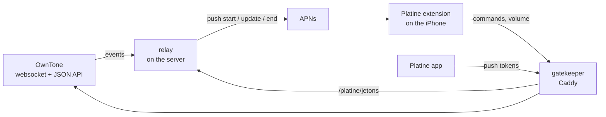
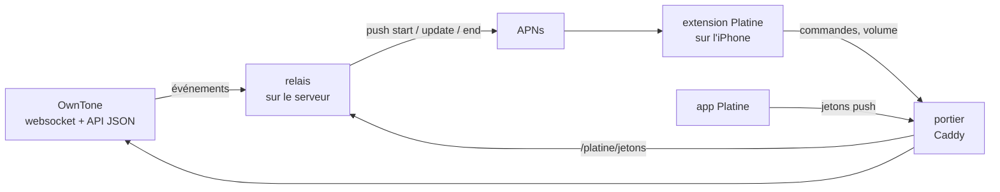

# Platine

[English](#english) · [Français](#français)

## English

Platine puts an [OwnTone](https://owntone.github.io/owntone-server/) music server on the iPhone's native Now Playing
surfaces (Control Center, Lock Screen, Dynamic Island) through the remote media sessions of iOS 27 (`NowPlaying`
framework). The card shows the track and its artwork, offers play, pause, next, previous and seek, and gives each
active speaker its own volume slider; the two speakers of a stereo pair are merged into a single row. The card follows
OwnTone even when the app is closed: a small relay on the server keeps it up to date with push notifications.

What we learned about remote media sessions along the way is written up in
[docs/ios27-remote-now-playing.md](docs/ios27-remote-now-playing.md).

**Status:** a personal project that runs every day on its author's setup. The app is installed from Xcode, so the relay
uses the development APNs environment. It is not on the App Store or TestFlight.

### How it works



- **App** (`Platine/`): reads OwnTone's state, can start or update the session while it is open, and hands its
  push-to-start token to the relay.
- **Extension** (`PlatineSession/`, extension point `com.apple.nowplaying.remote-media`): builds the card (content,
  playback state, commands, devices with their volume) and sends commands to OwnTone. It hands each session's push
  token to the relay, and quits when a newer build of itself has been installed.
- **Shared code** (`Commun/`): the `PlatineAttributs` contract carried by the session and its pushes, a small OwnTone
  client, the shared log and the push tokens.
- **Gatekeeper** (`portier/`): Caddy, listening on `127.0.0.1` behind the server's HTTPS reverse proxy. It requires a
  bearer token, lets through only an allowlist of OwnTone endpoints (state, player commands, output volume, artwork)
  plus the token route of the relay, and strips the token before forwarding. It exists because iOS denies the extension
  any access to the local network: the extension reaches OwnTone through a public HTTPS name instead.
- **Relay** (`relais/`, Go, one dependency): listens to OwnTone's websocket, reads the state back after one second of
  quiet (five at most), and decides on the pushes: `start` when playback begins and no card exists, `update` when the
  track, the state, an output or a volume changes (or on a seek), `end` two minutes after a stop and thirty minutes
  after a pause. It signs its APNs requests with an ES256 JWT over HTTP/2, keeps the tokens in a file (mode 600), listens
  on `127.0.0.1` only and talks to nothing but OwnTone and APNs. It runs in a read-only container capped at 32 MB.

### Requirements

- An iPhone on iOS 27 (27.2 for the stereo-pair icon), a Mac with Xcode and the iOS 27.2 SDK,
  [XcodeGen](https://github.com/yonaskolb/XcodeGen), and a paid Apple Developer Program membership (push notifications,
  an APNs authentication key).
- An OwnTone server, with Docker on the same host: the gatekeeper and the relay reach OwnTone on `127.0.0.1` (a
  Synology NAS in the author's setup).
- An HTTPS reverse proxy on that host with a public name that the iPhone can reach, at home and away.
- Go 1.27 to build the relay.

### Setup

1. **Gatekeeper.** Copy `portier/` to the server. In that folder, create a `.env` file (mode 600, never versioned) holding
   `PLATINE_JETON=<64 hexadecimal characters>` (for instance from `openssl rand -hex 32`), then run
   `docker compose up -d`. Point the reverse proxy from `https://<public name>` to `http://127.0.0.1:18089`.
2. **App.** Create `Config/Local.xcconfig` (not versioned, see `Config/Signing.xcconfig`):

   ```
   DEVELOPMENT_TEAM = <your team ID>
   PLATINE_PORTIER = https:/$()/<public name>
   PLATINE_JETON = <the gatekeeper token>
   PLATINE_PAIRES = <output id>+<output id>=<shown name>
   ```

   `PLATINE_PAIRES` is optional: comma-separated stereo pairs, given by OwnTone output ids. The bundle identifiers and
   the App Group use the author's prefix, `io.github.djoko-cli`: to build under your own team, replace it in
   `project.yml`, `Commun/JournalPartage.swift` and `scripts/essai-push.py`, and set `APP=<your app's bundle id>` in the
   relay's `.env`. Then build and install on the first connected iPhone with `scripts/construire.sh`.
3. **APNs key.** On the Apple developer portal, create a key with the Apple Push Notifications service enabled and
   download its `.p8` file (possible only once). Keep it as `~/.config/platine/apns/AuthKey_<key id>.p8`, mode 600.
4. **Relay.** `relais/banc.sh` runs it on the Mac against the server's OwnTone, for testing: it finds the server
   through the ssh alias `nas` (or `NAS=<host>`), and `relais/banc.sh jetons` hands it the tokens that
   `python3 scripts/essai-push.py recuperer` read from the iPhone. `relais/deployer.sh` compiles it for linux/amd64,
   copies it next to the gatekeeper on the server with its key and a generated `.env`, and backs up the gatekeeper's
   `Caddyfile` before updating it; `relais/deployer.sh lancer` builds and starts the container (it expects Docker at
   `/usr/local/bin/docker`, as on Synology DSM), and `relais/deployer.sh verifier` checks the gatekeeper's refusals
   through the public name. The script follows the author's layout: set `NAS_SSH`, `DOSSIER_RELAIS` and
   `DOSSIER_PORTIER` to match yours.
5. **First launch.** Open the app once the relay runs: it hands its push-to-start token to the relay (and again at every
   launch).

The relay writes its log to `donnees/relais.log` on the server. On the iPhone side, `python3 scripts/essai-push.py journal`
prints the extension's log from the Mac.

### Limits

- Development APNs only. A TestFlight or App Store build needs `aps-environment: production` and the production APNs
  server (`APNS_SERVEUR`).
- iOS decides when the card takes the Lock Screen, and we found no reliable trigger. Most often, a card started while
  the app is closed first appears in Control Center and moves to the Lock Screen and the Dynamic Island once the user
  touches it there. See the [notes](docs/ios27-remote-now-playing.md#4-lock-screen-and-control-center).
- One OwnTone server, one session.
- The card sets the volume of the active speakers; it does not turn speakers on or off.
- There is no HomePod device type: a stereo pair shows the "speaker group" icon (iOS 27.2), single speakers the
  generic speaker icon. iOS puts the device rows in its own order (alphabetical, as far as we saw).
- Comments, logs and the specification are written in French.
- Not affiliated with Apple or with the OwnTone project.

### License

[MIT](LICENSE).

## Français

Platine affiche un serveur de musique [OwnTone](https://owntone.github.io/owntone-server/) dans les écrans « À l'écoute »
natifs de l'iPhone (Centre de contrôle, écran verrouillé, Dynamic Island), grâce aux sessions distantes d'iOS 27
(framework `NowPlaying`). La carte montre le morceau et sa pochette, propose lecture, pause, suivant, précédent et
déplacement dans le morceau, et donne à chaque enceinte active son curseur de volume ; les deux enceintes d'une paire
stéréo n'y font qu'une ligne. La carte suit OwnTone même app fermée : un petit relais sur le serveur la tient à jour
par des notifications push.

Ce que nous avons appris des sessions distantes en chemin est rassemblé dans
[docs/ios27-remote-now-playing.md](docs/ios27-remote-now-playing.md).

**État :** un projet personnel, en service chaque jour chez son auteur. L'app est installée par Xcode : le relais
utilise donc l'environnement APNs de développement. Elle n'est ni sur l'App Store ni sur TestFlight.

### Le fonctionnement



- **L'app** (`Platine/`) : lit l'état d'OwnTone, peut démarrer ou mettre à jour la session tant qu'elle est ouverte, et
  donne au relais son jeton de démarrage par push.
- **L'extension** (`PlatineSession/`, point d'extension `com.apple.nowplaying.remote-media`) : construit la carte
  (contenu, état de lecture, commandes, appareils avec leur volume) et envoie les commandes à OwnTone. Elle donne au
  relais le jeton push de chaque session, et s'arrête quand une version plus récente d'elle-même a été installée.
- **Le code commun** (`Commun/`) : le contrat `PlatineAttributs` que transportent la session et ses push, un petit client
  d'OwnTone, le journal partagé et les jetons push.
- **Le portier** (`portier/`) : Caddy, à l'écoute sur `127.0.0.1` derrière le proxy inversé HTTPS du serveur. Il exige
  un jeton, ne laisse passer qu'une liste blanche de l'API d'OwnTone (état, commandes du lecteur, volume des sorties,
  pochettes) et la route des jetons du relais, et retire le jeton avant de transmettre. Il existe parce qu'iOS refuse à
  l'extension tout accès au réseau local : l'extension joint OwnTone par un nom public en HTTPS.
- **Le relais** (`relais/`, en Go, une seule dépendance) : écoute la websocket d'OwnTone, relit l'état après une seconde
  de calme (cinq au plus) et décide des push : `start` quand une lecture démarre sans carte, `update` quand la piste,
  l'état, une sortie ou un volume change (ou sur un saut dans le morceau), `end` deux minutes après un arrêt et trente
  minutes après une pause. Il signe ses requêtes APNs par un JWT ES256 en HTTP/2, garde les jetons dans un fichier
  (droits 600), n'écoute que sur `127.0.0.1` et ne parle qu'à OwnTone et à APNs. Il tourne dans un conteneur en lecture
  seule, limité à 32 Mo.

### Prérequis

- Un iPhone sous iOS 27 (27.2 pour l'icône de la paire stéréo), un Mac avec Xcode et le SDK d'iOS 27.2,
  [XcodeGen](https://github.com/yonaskolb/XcodeGen), et une adhésion payante au programme développeur d'Apple
  (notifications push, clé d'authentification APNs).
- Un serveur OwnTone, avec Docker sur le même hôte : le portier et le relais joignent OwnTone sur `127.0.0.1` (un NAS
  Synology chez l'auteur).
- Sur cet hôte, un proxy inversé HTTPS avec un nom public que l'iPhone joint, à la maison comme dehors.
- Go 1.27 pour compiler le relais.

### L'installation

1. **Le portier.** Copier `portier/` sur le serveur. Dans ce dossier, créer un fichier `.env` (droits 600, jamais versionné) qui
   contient `PLATINE_JETON=<64 caractères hexadécimaux>` (par exemple tirés de `openssl rand -hex 32`), puis lancer
   `docker compose up -d`. Faire pointer le proxy inversé de `https://<nom public>` vers `http://127.0.0.1:18089`.
2. **L'app.** Créer `Config/Local.xcconfig` (non versionné, voir `Config/Signing.xcconfig`) :

   ```
   DEVELOPMENT_TEAM = <identifiant de votre équipe>
   PLATINE_PORTIER = https:/$()/<nom public>
   PLATINE_JETON = <le jeton du portier>
   PLATINE_PAIRES = <id de sortie>+<id de sortie>=<nom affiché>
   ```

   `PLATINE_PAIRES` est facultatif : des paires stéréo séparées par des virgules, données par les identifiants des
   sorties d'OwnTone. Les identifiants de l'app et le groupe d'apps partagé (App Group) portent le préfixe de l'auteur,
   `io.github.djoko-cli` : pour compiler sous votre propre équipe, le remplacer dans `project.yml`,
   `Commun/JournalPartage.swift` et `scripts/essai-push.py`, et régler `APP=<identifiant de votre app>` dans le `.env`
   du relais. Compiler et installer ensuite sur le premier iPhone branché avec `scripts/construire.sh`.
3. **La clé APNs.** Sur le portail développeur d'Apple, créer une clé avec le service Apple Push Notifications et
   télécharger son fichier `.p8` (possible une seule fois). La garder en `~/.config/platine/apns/AuthKey_<id de la clé>.p8`,
   droits 600.
4. **Le relais.** `relais/banc.sh` le fait tourner sur le Mac face à l'OwnTone du serveur, pour les essais : il trouve
   le serveur par l'alias ssh `nas` (ou `NAS=<hôte>`), et `relais/banc.sh jetons` lui donne les jetons que
   `python3 scripts/essai-push.py recuperer` a lus sur l'iPhone. `relais/deployer.sh` le compile pour linux/amd64, le
   copie à côté du portier sur le serveur avec sa clé et un `.env` généré, et sauvegarde le `Caddyfile` du portier avant
   de le mettre à jour ; `relais/deployer.sh lancer` construit et démarre le conteneur (il attend Docker en
   `/usr/local/bin/docker`, comme sur DSM de Synology), et `relais/deployer.sh verifier` contrôle les refus du portier
   par le nom public. Le script suit l'organisation de l'auteur : régler `NAS_SSH`, `DOSSIER_RELAIS` et
   `DOSSIER_PORTIER` selon la vôtre.
5. **Le premier lancement.** Ouvrir l'app une fois le relais en service : elle lui donne son jeton de démarrage par push
   (et le redonne à chaque lancement).

Le relais écrit son journal dans `donnees/relais.log` sur le serveur. Côté iPhone, `python3 scripts/essai-push.py journal`
affiche depuis le Mac le journal de l'extension.

### Les limites

- APNs de développement seulement. Une version TestFlight ou App Store demande `aps-environment: production` et le
  serveur APNs de production (`APNS_SERVEUR`).
- iOS décide quand la carte prend l'écran verrouillé, et nous n'avons trouvé aucun déclencheur sûr. Le plus souvent,
  une carte démarrée app fermée apparaît d'abord dans le Centre de contrôle, et passe sur l'écran verrouillé et dans la
  Dynamic Island dès que l'utilisateur l'y touche. Voir les [notes](docs/ios27-remote-now-playing.md#4-écran-verrouillé-et-centre-de-contrôle).
- Un seul serveur OwnTone, une seule session.
- La carte règle le volume des enceintes actives ; elle n'allume ni n'éteint d'enceinte.
- Aucun type d'appareil HomePod : une paire stéréo prend l'icône « groupe d'enceintes » (iOS 27.2), une enceinte seule
  l'icône générique. iOS range les lignes des appareils dans son propre ordre (alphabétique, d'après nos essais).
- Commentaires, journaux et spécification sont en français.
- Sans lien avec Apple ni avec le projet OwnTone.

### Licence

[MIT](LICENSE).
