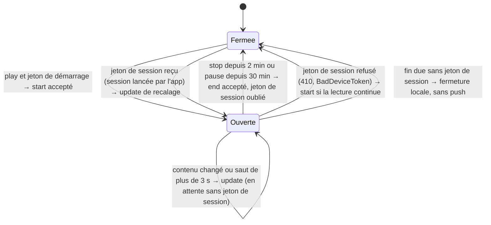

# Relais des push de Platine : plan d'exécution

**Statut :** abandonné (31/10/2026). Le relais a été construit par une autre voie (dossier `relais/`, résultats du banc
dans la spec) ; de ce plan, seul l'arrêt de l'extension périmée a été repris, corrigé. Ne pas exécuter.

> **Pour les agents :** sous-skill requise : `superpowers:subagent-driven-development` (recommandé) ou
> `superpowers:executing-plans`, tâche par tâche. Chaque étape est une case (`- [ ]`) : la cocher dès qu'elle est faite
> et vérifiée, et la commiter avec le travail de la tâche.

**But :** un service sur le NAS suit OwnTone et tient la carte « en cours de lecture » de Platine à jour par des push
`nowplaying` (start, update, end), app fermée ; l'app et l'extension lui donnent leurs jetons push par le portier.

**Architecture :** le relais (Go) écoute la websocket d'OwnTone, regroupe les événements, relit l'état par l'API JSON,
décide des push par une machine d'états pure et les envoie à APNs en HTTP/2, signées par un JWT ES256. Il reçoit les
jetons sur `127.0.0.1:18090`, joint seulement par une nouvelle route du portier, et les garde dans un fichier d'état
(600). Binaire statique compilé sur le Mac, image `FROM scratch` construite sur le NAS sans téléchargement.

**Technique :** Go 1.27 (bibliothèque standard et `github.com/coder/websocket` v1.8.15), Caddy 2.11.7 (portier),
Docker 24.0.2 et Compose 2.20 sur le NAS, Swift 6 (app et extension, iOS 27).

**Spec :** `docs/specs/2026-10-31-push-nowplaying.md`. Référence des push qui marchent : `scripts/essai-push.py`
(en-têtes, JWT, charge utile).

**Branche :** `relais-push`, créée depuis `main` ; un commit par tâche.

## Contraintes générales

- Dépendances du relais : bibliothèque standard de Go et `github.com/coder/websocket v1.8.15`, rien d'autre ; versions
  figées par `go.mod` et `go.sum`, sommes vérifiées par `sum.golang.org` (`go mod verify`).
- Push : `POST https://api.sandbox.push.apple.com/3/device/<jeton>`, en-têtes `authorization: bearer <JWT>`,
  `apns-push-type: nowplaying`, `apns-topic: io.github.djoko-cli.platine.push-type.nowplaying`, `apns-priority: 10`,
  rien d'autre.
- Charge utile : `{"aps":{"event":"start"|"update"|"end","timestamp":<entier, secondes>,"attributes":<attributs>}}` ;
  pour `end`, `attributes` vaut `{"id":"owntone"}`.
- Attributs : les clés de `PlatineAttributs` (`Commun/OwnTone.swift`), toutes présentes : `id`, `serveur`, `etat`,
  `pisteID`, `titre`, `artiste`, `album`, `pochette`, `dureeMs`, `positionMs`, `horodatage`,
  `appareils` (`id`, `nom`, `volume`). `horodatage` est un **nombre** de secondes depuis 1970 (une date en texte fait
  rejeter la push). `id` vaut `owntone` (`Relais.idSession` de l'app).
- JWT : en-tête `{"alg":"ES256","kid":<identifiant de la clé>}`, revendications `{"iss":<équipe>,"iat":<secondes>}`,
  renouvelé à 50 min, jamais plus d'une fois en 20 min.
- Délais de la spec : regroupement sur 1 s, dernier état seulement ; `end` 2 min après `stop`, 30 min après `pause` ;
  pas de push pour l'avancement, une push sur un saut.
- Le relais n'écoute que `127.0.0.1:18090` et ne sort que vers APNs ; conteneur en lecture seule, sans capacités,
  mémoire plafonnée, journaux tournants.
- Journaux : jamais un jeton push en entier (suffixe de 4 caractères au plus : `…abcd`), jamais le JWT, la clé, le
  jeton du portier ni l'adresse du portier.
- Secrets (`.env`, clé `.p8`, `Config/Local.xcconfig`, jeton du portier) : jamais affichés ni lus à l'écran ; ils
  passent par des tubes (`ssh nas '… cat > fichier'`), fichiers en 600, dossier des données en 700. Jamais
  `docker compose config` sans `--quiet`, jamais `docker inspect` sans `--format` : les deux afficheraient le `.env`.
- Anonymat : aucune adresse IP, aucun nom de domaine réel, identifiant d'appareil, de sortie, d'équipe ou de clé, nom
  réel ni chemin `/Users/…` dans un fichier versionné ou un message de commit. Valeurs inventées dans les tests :
  `https://portier.example`, `EQUIPE0001`, `CLE0000001`, sorties `1001`, `1003` et `1005` (« Enceinte 1 »…), jetons
  `strings.Repeat("0a", 80)`. Gardes `.githooks` actives, `--no-verify` interdit.
- Style : identifiants et commentaires en français ; messages de commit en français, sujet donné par chaque tâche,
  terminés par une ligne vide puis `Co-Authored-By: Claude Opus 5.5 <noreply@anthropic.com>`.
- Pour les agents : chaque commande Bash porte une `description` courte en français (Djoko suit le travail en direct).

## Constats faits pour ce plan (31/10, en lecture seule)

- **OwnTone 29.3** : `websocket_port` 3688 ; la poignée de main websocket réussit et renvoie le protocole `notify`.
  `/api/player` donne `state`, `item_id`, `item_length_ms`, `item_progress_ms` ; `/api/outputs` donne `id` (texte),
  `name`, `selected`, `volume` ; `/api/queue?id=<item_id>` rend un seul élément (environ 0,7 Ko, contre 33 Ko pour une
  file de 50 morceaux), dont `artwork_url` a la forme `./artwork/item/<n>?v=<version de la file>`.
- **Source d'OwnTone** : la fin naturelle d'un morceau (`event_play_start`) et un saut par `PUT /api/player/seek`
  (suivi de `player_playback_start`, même en pause) notifient `player` ; un volume changé, y compris rapporté par
  l'enceinte (`device_streaming_cb`), notifie `volume` et `outputs`. Abonnement `{"notify":[…]}`, messages reçus
  `{"notify":["player"]}`, aucun ping côté OwnTone.
- **NAS** : Docker 24.0.2 **sans buildx** (constructeur classique), Compose 2.20.1, `netstat` (pas de `ss`), `bash`.
  Port 18090 libre. `/etc/ssl/certs/ca-certificates.crt` présent ; APNs bac à sable joignable avec lui en HTTP/2
  (vérification TLS 0). `/etc/localtime` est un fuseau valide. L'utilisateur SSH n'est pas root mais pilote Docker. Le
  portier a été créé par `docker compose` depuis son dossier (projet `platine-portier`). `/volume2/docker` porte des
  ACL (`+`), qu'un `chmod 600` retire (cas du `.env` du portier).
- **Jetons de l'essai** : 160 caractères hexadécimaux minuscules, démarrage comme session.
- **Mac** : Go 1.27.1.

## Choix techniques tranchés

| Sujet | Choix | Raison |
|---|---|---|
| Suivi d'OwnTone | websocket `ws://127.0.0.1:3688/`, protocole `notify`, abonnement `{"notify":["player","outputs","volume","queue"]}`, client `coder/websocket` (validé par le pilote) | réaction immédiate, rien à faire quand rien ne joue |
| Filet | relecture de contrôle toutes les 30 s | rattrape un événement manqué ou une dérive de position ; trois requêtes locales |
| Saut dans le morceau | position lue comparée à la position extrapolée de la dernière push, seuil 3 s | OwnTone notifie `player` après un saut fait par l'API ; le filet couvre les autres clients |
| Regroupement | relecture 1 s après le dernier événement d'une rafale, au plus tard 5 s après le premier | un curseur qui glisse donne une seule push, envoyée après le geste : la carte ne fait pas sauter le curseur sous le doigt ; le plafond borne l'attente |
| File d'OwnTone | `GET /api/queue?id=<item_id>` | un seul élément au lieu de la file entière, cohérent avec `item_id` du même relevé |
| Pochette | `artwork_url` de l'élément résolue sur l'adresse du portier ; changement jugé sans le paramètre `v` | `v` est la version de la file : la moindre retouche de la file le change sans changer la pochette |
| Ce qui mérite une push | tout l'état sauf position et horodatage, titres compris | un flux radio change de titre sans changer de piste |
| `timestamp` APNs | `max(maintenant, précédent + 1)`, en secondes | un `start` puis un `update` dans la même seconde ne doivent pas porter le même horodatage |
| Reprise | fichier d'état `{"demarrage","session","ouverte"}` ; une session ouverte n'est jamais redémarrée | pas de deuxième carte après un redémarrage, au pire une mise à jour de recalage |
| Client APNs | un seul `http.Client`, HTTP/2 seul (`Transport.Protocols`), TLS 1.2 minimum, délai 10 s, connexion inactive fermée à 5 min, une reprise immédiate après une erreur réseau | connexion réutilisée ; pas de push perdue sur une connexion coupée par la box |
| Recul | 429, 5xx, réseau : 2 s doublé jusqu'à 60 s ; 403 : 5 min ; autre refus : 60 s ; on renvoie l'état du moment, pas l'ancien | pas de rafale vers APNs, pas d'état périmé |
| Image | `FROM scratch` : binaire statique (`CGO_ENABLED=0`, `-trimpath`) et certificats racine du NAS ; constructeur classique (`DOCKER_BUILDKIT=0`) ; `.dockerignore` qui n'admet que ces deux fichiers | rien à télécharger, pas de buildx sur le NAS, la clé et le `.env` n'entrent jamais dans le contexte de construction |
| Utilisateur du conteneur | uid:gid de l'utilisateur SSH du NAS, écrit dans `.env` | sans root, la clé et l'état (600, à cet utilisateur) restent lisibles |
| Heure des journaux | `/etc/localtime` du NAS monté en lecture seule | heure locale, sans nom de fuseau dans le dépôt |
| Durées de fin | `RELAIS_FIN_ARRET`, `RELAIS_FIN_PAUSE` (2m et 30m par défaut) | raccourcies au banc sans recompiler |
| Ordre | relais, puis route du portier, puis app et extension (la spec mettait l'app avant la route) | l'envoi des jetons par l'app ne se vérifie qu'une fois la route en place |

## Points de vigilance (Review Focus)

1. **Aucune enceinte active** : `appareils` doit partir `[]`, jamais `null`, sinon le décodeur de l'app rejette la push
   sans bruit. Test : `TestChargeUtileAppareilsVides` (tâche 1).
2. **Redémarrage du relais pendant une lecture** : pas de deuxième `start`, une seule mise à jour de recalage. Tests :
   `TestRepriseSessionOuverte` (tâche 3), `TestBoucleRepriseSansDoublon` (tâche 6).
3. **Curseur de volume qui glisse sur la carte** : aucune push pendant le geste, une seule après. Tests :
   `TestRegroupementRafale`, `TestRegroupementPlafond` (tâche 3), `TestBoucleRegroupeUneRafale` (tâche 6).
4. **Jeton remplacé pendant qu'une push à l'ancien échoue (410)** : le nouveau jeton n'est pas effacé. Test :
   `TestMagasinOublieSeulementLeJetonRefuse` (tâche 5).
5. **`start` accepté par APNs, mais aucun jeton de session n'arrive** : le relais garde les mises à jour en attente et
   le dit dans son journal au bout de 2 min. Tests : `TestMiseAJourEnAttenteDuJetonDeSession` (tâche 3),
   `TestBoucleAlerteSansJetonDeSession` (tâche 6).

## Carte des fichiers

Créés, dans `relais/` (module `platine/relais`, paquet `main`) :

| Fichier | Rôle |
|---|---|
| `go.mod`, `go.sum` | module et dépendance figée |
| `attributs.go` | contrat `PlatineAttributs`, charge utile, comparaison, extrapolation |
| `owntone.go` | lecture de l'état par l'API JSON d'OwnTone |
| `ecoute.go` | websocket d'OwnTone, reconnexion |
| `regroupement.go` | regroupement des événements |
| `session.go` | machine d'états de la session, pure (ni horloge ni réseau) |
| `apns.go` | clé, JWT ES256, client HTTP/2, classement des réponses |
| `magasin.go` | fichier d'état (jetons, session ouverte), écriture atomique en 600 |
| `enregistrement.go` | `POST /platine/jetons` sur `127.0.0.1:18090` |
| `relais.go` | boucle qui relie tout : minuteries, recul, journal |
| `main.go` | réglages par l'environnement, démarrage, arrêt propre |
| `*_test.go` | un fichier de tests par fichier ci-dessus |
| `Dockerfile`, `.dockerignore`, `compose.yaml` | image et conteneur sur le NAS |

Créés aussi : `scripts/installer-secrets-relais.sh`, `scripts/deployer-relais.sh`.

Modifiés : `.gitignore`, `portier/Caddyfile`, `Commun/JetonsPush.swift`, `Commun/OwnTone.swift`,
`Platine/PlatineApp.swift`, `PlatineSession/ExtensionPlatine.swift`, `scripts/essai-push.py`, la spec (résultats du
banc).

## La machine d'états



Les délais de fin courent depuis le dernier changement d'état d'OwnTone ou depuis l'ouverture de la session, le plus
récent des deux.

---

### Tâche 1 : attributs, charge utile et lecture d'OwnTone

**Fichiers :**
- Créer : `relais/go.mod` (`cd relais && go mod init platine/relais`), `relais/attributs.go`,
  `relais/attributs_test.go`, `relais/owntone.go`, `relais/owntone_test.go`
- Modifier : `.gitignore` (ajouter `relais/relais`, binaire d'une compilation locale)

**Interfaces :**
- Produit :

```go
const IDSession = "owntone"

type Appareil struct {
	ID     string `json:"id"`
	Nom    string `json:"nom"`
	Volume int    `json:"volume"` // 0 à 100
}

// Attributs : PlatineAttributs de Commun/OwnTone.swift, clé pour clé.
type Attributs struct {
	ID         string     `json:"id"`
	Serveur    string     `json:"serveur"`
	Etat       string     `json:"etat"` // "play", "pause" ou "stop"
	PisteID    int        `json:"pisteID"`
	Titre      string     `json:"titre"`
	Artiste    string     `json:"artiste"`
	Album      string     `json:"album"`
	Pochette   string     `json:"pochette"`
	DureeMs    int        `json:"dureeMs"`
	PositionMs int        `json:"positionMs"`
	Horodatage float64    `json:"horodatage"` // secondes depuis 1970, fraction comprise
	Appareils  []Appareil `json:"appareils"`
}

func (a Attributs) MemeContenu(b Attributs) bool     // tout sauf PositionMs, Horodatage et le paramètre v de Pochette
func (a Attributs) PositionA(horodatage float64) int // position extrapolée en ms ; n'avance qu'en "play"
func ChargeUtile(evenement string, a Attributs, horodatage int64) ([]byte, error)
var ErrChargeTropGrosse = errors.New("charge utile de plus de 4096 octets")
func HorodatagePush(maintenant time.Time, precedent int64) int64 // max(maintenant.Unix(), precedent+1)

type OwnTone struct {
	Base       string       // "http://127.0.0.1:3689"
	Portier    string       // adresse publique du portier : Serveur des attributs, base des pochettes
	HTTP       *http.Client // délai 3 s
	Maintenant func() time.Time
}

func (o OwnTone) LireEtat(ctx context.Context) (Attributs, error)
```

- Produit pour les tests des tâches suivantes : `attributsExemple() Attributs` (dans `attributs_test.go`) : `ID`
  `"owntone"`, `Serveur` `"https://portier.example"`, `Etat` `"play"`, `PisteID` 42, `Titre` `"Titre 1"`, `Artiste`
  `"Artiste 1"`, `Album` `"Album 1"`, `Pochette` `"https://portier.example/artwork/item/42?v=7"`, `DureeMs` 200000,
  `PositionMs` 10000, `Horodatage` 1800000000.25, appareils `{"1001", "Enceinte 1", 40}` et `{"1005", "Enceinte 2", 55}`.

**`LireEtat`, calqué sur `ClientOwnTone.lireEtat` :**
- `GET /api/player` ; `Horodatage` = `Maintenant()` pris juste après cette réponse ;
- `GET /api/outputs` : les sorties `selected`, dans l'ordre d'OwnTone → `Appareils` (tranche vide, jamais nil) ;
- si `item_id ≠ 0` : `GET /api/queue?id=<item_id>`, élément de même `id`, sinon aucun ;
- `PisteID` = `id` de l'élément ou 0 ; `Titre`, `Artiste`, `Album` = ceux de l'élément ou `""`, tronqués à 256
  caractères (runes) ; `DureeMs` = `length_ms` de l'élément s'il est présent, sinon `item_length_ms` ; `PositionMs` =
  `item_progress_ms` ;
- `Serveur` = `Portier` sans `/` final ; `Pochette` = `artwork_url` de l'élément résolue sur `Portier + "/"`
  (`url.ResolveReference` : une adresse absolue reste telle quelle), `""` sans pochette ;
- statut hors 2xx ou JSON invalide → erreur qui nomme le chemin, jamais l'adresse du portier.

- [ ] **Étape 1 : écrire les tests des attributs** (`attributs_test.go`)
  - `TestChargeUtileUpdate` : `ChargeUtile("update", attributsExemple(), 1800000001)` décodée → `aps.event == "update"`,
    `aps.timestamp == 1800000001`, `aps.attributes` a exactement les 12 clés du contrat et chaque appareil exactement
    `id`, `nom`, `volume`.
  - `TestChargeUtileStart` : `aps.event == "start"`, attributs complets.
  - `TestChargeUtileEnd` : `aps.attributes` vaut exactement `{"id":"owntone"}`.
  - `TestChargeUtileHorodatageNombre` : le JSON brut contient `"horodatage":1800000000.25`.
  - `TestChargeUtileAppareilsVides` : `Appareils = nil` → le JSON brut contient `"appareils":[]`.
  - `TestChargeUtileTropGrosse` : 40 appareils au nom de 64 caractères → `errors.Is(err, ErrChargeTropGrosse)` ;
    8 appareils au nom de 64 caractères et titre, artiste, album de 256 caractères → pas d'erreur, 4096 octets au plus.
  - `TestMemeContenu` : vrai quand seuls `PositionMs`, `Horodatage` ou la valeur de `v` dans `Pochette` changent ; faux
    pour `Etat`, `PisteID`, `Titre`, un `Volume`, un appareil de plus, ou une `Pochette` changée hors `v`.
  - `TestPositionA` : en `play`, `PositionA(1800000020.25) == 30000` ; en `pause` et en `stop`, `10000`.
  - `TestHorodatagePush` : `HorodatagePush(t, 0) == t.Unix()` ; `HorodatagePush(t, t.Unix()) == t.Unix()+1`.

- [ ] **Étape 2 : écrire les tests de lecture** (`owntone_test.go` : serveur `httptest` aux réponses fixes, `Maintenant`
  rend `time.Unix(1800000000, 250_000_000)`, `Portier` vaut `https://portier.example`)
  - `TestLireEtatLecture` : lecteur `{"state":"play","item_id":42,"item_length_ms":199000,"item_progress_ms":10000,"artwork_url":"./artwork/nowplaying"}` ;
    sorties `1001` (choisie, 40), `1005` (non choisie), `1003` (choisie, 55) ; file pour `id=42` (paramètre vérifié par
    le serveur) : `{"items":[{"id":42,"title":"Titre 1","artist":"Artiste 1","album":"Album 1","length_ms":200000,"artwork_url":"./artwork/item/42?v=7"}]}`
    → `PisteID` 42, `DureeMs` 200000, `PositionMs` 10000, `Horodatage` 1800000000.25, `Serveur`
    `"https://portier.example"`, `Pochette` `"https://portier.example/artwork/item/42?v=7"`, appareils `1001` puis `1003`.
  - `TestLireEtatSansPiste` : `item_id` 0 → aucune requête sur `/api/queue`, `PisteID` 0, textes et `Pochette` vides,
    `DureeMs` = `item_length_ms` ; aucune sortie choisie → `Appareils` non nil et vide.
  - `TestLireEtatPisteDisparue` : file `{"items":[]}` → `PisteID` 0, `DureeMs` = `item_length_ms`.
  - `TestLireEtatTitreTronque` : titre de 1000 « é » → 256 runes, UTF-8 valide.
  - `TestLireEtatPortierAvecBarre` : `Portier` `"https://portier.example/"` → `Serveur` sans barre finale, pochette sans
    `//artwork`.
  - `TestLireEtatErreur` : `/api/outputs` répond 500 → erreur non nulle.

- [ ] **Étape 3 : vérifier l'échec**
  Commande : `cd relais && go test ./...` → compilation impossible (`undefined: Attributs`).

- [ ] **Étape 4 : écrire `attributs.go` et `owntone.go`**
  `ChargeUtile` encode `{"aps":{"event","timestamp","attributes"}}` ; pour `end`, `attributes` est `{"id":IDSession}` ;
  un `Appareils` nil devient une tranche vide avant l'encodage ; au-delà de 4096 octets, `ErrChargeTropGrosse`.
  `MemeContenu` retire le seul paramètre `v` de la pochette (`url.Parse`, `Query().Del("v")`) avant de comparer.

- [ ] **Étape 5 : vérifier**
  Commande : `cd relais && gofmt -l . && go vet ./... && go test ./... -v` → `gofmt` muet, tous les tests `PASS`.

- [ ] **Étape 6 : commiter** `.gitignore` et `relais/` — « Relais : attributs, charge utile des push et lecture d'OwnTone »

---

### Tâche 2 : écoute de la websocket d'OwnTone

**Fichiers :**
- Créer : `relais/ecoute.go`, `relais/ecoute_test.go`, `relais/go.sum`
- Modifier : `relais/go.mod`

**Interfaces :**
- Produit :

```go
type Ecoute struct {
	Adresse  string        // "ws://127.0.0.1:3688/"
	ReculMin time.Duration // 1 s
	ReculMax time.Duration // 30 s
	Journal  *log.Logger
}

// Lancer tient la websocket ouverte jusqu'à la fin de ctx. Elle signale (envoi non bloquant ; le canal a un tampon
// de 1) à chaque connexion réussie, pour une relecture complète, et à chaque message reçu.
func (e Ecoute) Lancer(ctx context.Context, signal chan<- struct{})
```

**Comportement :** `websocket.Dial(ctx, Adresse, &websocket.DialOptions{Subprotocols: []string{"notify"}})` ; envoi du
texte exact `{"notify":["player","outputs","volume","queue"]}` ; un signal ; puis `Read` en boucle, un signal par
message (contenu non analysé). Sur erreur : `CloseNow`, attente du recul (doublé de `ReculMin` à `ReculMax`, remis à
`ReculMin` après un abonnement réussi), nouvel essai. Journal aux seuls changements : `websocket d'OwnTone connectée`,
`websocket d'OwnTone perdue : <erreur>`.

- [ ] **Étape 1 : ajouter la dépendance**
  Commande : `cd relais && go get github.com/coder/websocket@v1.8.15 && go mod verify` → `all modules verified` ;
  `go.mod` porte `require github.com/coder/websocket v1.8.15`, `go.sum` ses deux lignes `v1.8.15`.

- [ ] **Étape 2 : écrire les tests** (serveur `httptest` dont le gestionnaire fait
  `websocket.Accept(w, r, &websocket.AcceptOptions{Subprotocols: []string{"notify"}})` ; `ReculMin` 10 ms, `ReculMax` 50 ms)
  - `TestEcouteSAbonneEtSignale` : le premier message lu par le serveur vaut exactement l'abonnement et
    `c.Subprotocol() == "notify"` ; le test reçoit un signal (connexion) ; le serveur écrit alors
    `{"notify":["volume"]}` → second signal en moins d'1 s.
  - `TestEcouteSeReconnecte` : le serveur ferme chaque connexion après l'abonnement ; le test vide le canal en continu
    → au moins 3 connexions et 3 signaux en moins d'1 s.
  - `TestEcouteSArreteAvecLeContexte` : serveur arrêté (le recul tourne), `cancel()` → `Lancer` rend la main en moins
    de 200 ms.

- [ ] **Étape 3 : vérifier l'échec** — `cd relais && go test ./... -run TestEcoute` → `undefined: Ecoute`.

- [ ] **Étape 4 : écrire `ecoute.go`**

- [ ] **Étape 5 : vérifier**
  Commande : `cd relais && go mod tidy && go mod verify && gofmt -l . && go vet ./... && go test ./... -run TestEcoute -count=3 -v`
  → `go.mod` sans `// indirect` sur `coder/websocket` (toujours en v1.8.15), `PASS` trois fois.

- [ ] **Étape 6 : commiter** `relais/` — « Relais : écoute de la websocket d'OwnTone (coder/websocket v1.8.15) »

---

### Tâche 3 : regroupement et machine d'états de la session

**Fichiers :**
- Créer : `relais/regroupement.go`, `relais/regroupement_test.go`, `relais/session.go`, `relais/session_test.go`

**Interfaces :**
- Consomme : `Attributs`, `MemeContenu`, `PositionA`, `attributsExemple` (tâche 1).
- Produit :

```go
type Regroupeur struct {
	Calme time.Duration // 1 s : relecture 1 s après le dernier événement
	Max   time.Duration // 5 s : au plus tard 5 s après le premier
	// non exportés : premier, dernier time.Time ; enCours bool
}

func (r *Regroupeur) Signaler(t time.Time)
func (r *Regroupeur) Echeance() (time.Time, bool) // min(dernier+Calme, premier+Max) ; false sans événement en attente
func (r *Regroupeur) Vider()                       // relecture faite : la fenêtre suivante part du prochain événement

type ResultatAPNs int

const (
	Accepte       ResultatAPNs = iota // 200
	JetonInvalide                     // 410, ou 400 BadDeviceToken / DeviceTokenNotForTopic : jeton à oublier
	Temporaire                        // 429, 500, 503, erreur réseau : recul, puis l'état du moment
	AuthRefusee                       // 403 : clé, équipe ou JWT refusés
	Rejete                            // autre refus : défaut de la push elle-même
)

type Disponibles struct{ Demarrage, Session bool } // jetons connus du magasin

type Envoi struct {
	Evenement string // "start", "update" ou "end"
	Attributs Attributs
}

func (e Envoi) Cible() string // "demarrage" pour start, "session" sinon

type Machine struct {
	Ouverte            bool       // une session existe sur l'iPhone, d'après le relais
	Envoye             *Attributs // ce que montre la carte, d'après les push acceptées ; nil : inconnu
	Vu                 *Attributs // dernier état lu d'OwnTone
	EtatDepuis         time.Time  // début de l'état courant de Vu (play, pause ou stop)
	OuverteA           time.Time  // ouverture : start accepté ou jeton de session reçu
	FinArret, FinPause time.Duration
}

func NouvelleMachine(ouverte bool, finArret, finPause time.Duration) *Machine
func (m *Machine) Lu(a Attributs, t time.Time)              // EtatDepuis = t au premier relevé et à chaque changement d'Etat
func (m *Machine) Decider(t time.Time, d Disponibles) *Envoi // nil : rien à envoyer
func (m *Machine) JetonSession(t time.Time)                  // fermée → ouverte, Envoye = nil, OuverteA = t ; ouverte : rien
func (m *Machine) Resultat(e Envoi, r ResultatAPNs, t time.Time)
func (m *Machine) ProchaineEcheance() (time.Time, bool)      // max(EtatDepuis, OuverteA) + délai ; false si fermée ou en play
```

**Règles de `Decider`, dans cet ordre :**
1. `Vu == nil` → nil.
2. Ouverte, `Vu.Etat ≠ "play"` et `t ≥ ProchaineEcheance()` : avec jeton de session → `end` ; sans → fermeture locale
   (`Ouverte = false`, `Envoye = nil`) et nil.
3. Fermée : `Vu.Etat == "play"` et jeton de démarrage → `start` avec `*Vu` ; sinon nil (pause et stop ne démarrent
   jamais).
4. Ouverte, jeton de session connu, et `Envoye == nil`, ou `!Vu.MemeContenu(*Envoye)`, ou saut → `update` avec `*Vu`.
5. Sinon nil. Ouverte sans jeton de session : on attend, l'arrivée du jeton relance la décision.

Saut : même `Etat` et même `PisteID`, `Etat ≠ "stop"`, et `|Vu.PositionMs − Envoye.PositionA(Vu.Horodatage)| > 3000`.
Délai : `FinPause` pour `pause`, `FinArret` pour `stop` et toute autre valeur que `play`.
`Resultat` : `Accepte` : `start` → ouverte, `OuverteA = t`, `Envoye` = attributs envoyés ; `update` → `Envoye` =
attributs envoyés ; `end` → fermée, `Envoye = nil`. `JetonInvalide` sur la cible `session` → fermée, `Envoye = nil`.
Les autres résultats ne changent rien.

- [ ] **Étape 1 : écrire les tests du regroupement** (`regroupement_test.go`, `Calme` 1 s, `Max` 5 s, `t0` quelconque)
  - `TestRegroupementUnEvenement` : `Signaler(t0)` → `Echeance() == (t0+1s, true)`.
  - `TestRegroupementRafale` : signaux à `t0`, `t0+300ms`, `t0+800ms` → `t0+1,8s`.
  - `TestRegroupementPlafond` : un signal toutes les 500 ms de `t0` à `t0+10s` → après chacun, échéance au plus
    `t0+5s`.
  - `TestRegroupementVider` : après `Vider`, `(_, false)` ; `Signaler(t1)` → `t1+1s` (nouvelle fenêtre).

- [ ] **Étape 2 : écrire les tests de la machine** (`session_test.go` : `t0 = time.Unix(1800000000, 0)`, `FinArret`
  2 min, `FinPause` 30 min ; assistant `lu(etat string, piste, positionMs int, t time.Time) Attributs` tiré
  d'`attributsExemple()` avec `Horodatage = float64(t.Unix())`)
  - `TestDemarrageQuandLaLectureCommence` : fermée, `Lu(play)`, `Disponibles{Demarrage: true}` → `start` ; après
    `Resultat(Accepte)`, ouverte et `Envoye` = ces attributs.
  - `TestPasDeDemarrageSansJetonNiEnPause` : fermée, play sans jeton de démarrage → nil ; pause ou stop avec jeton → nil.
  - `TestMiseAJourEnAttenteDuJetonDeSession` : `start` accepté, piste changée, `Disponibles{Demarrage: true}` → nil ;
    `JetonSession` puis `Decider` avec `Session: true` → `update` portant la piste nouvelle.
  - `TestMiseAJourSurChangement` : volume d'un appareil changé → `update`.
  - `TestPasDeMiseAJourPourLAvancement` : play, position qui suit l'extrapolation à 2,5 s près → nil.
  - `TestSautDansLeMorceau` : play, écart de 3001 ms → `update` ; écart de 3000 ms → nil ; en pause, position avancée
    de 5000 ms → `update`.
  - `TestFinDeuxMinutesApresArret` : stop lu à `t0`, `update` accepté ; `ProchaineEcheance() == t0+2min` ;
    `Decider(t0+2min−1s)` → nil ; `Decider(t0+2min)` → `end` ; `Resultat(Accepte)` → fermée.
  - `TestFinTrenteMinutesApresPause` : pause à `t0` → `end` à `t0+30min`, pas avant.
  - `TestLectureAnnuleLaFin` : pause à `t0`, play à `t0+10min` → `Decider(t0+31min)` ne rend pas `end`.
  - `TestFinCompteDepuisOuverture` : pause depuis `t0`, `JetonSession(t0+40min)` → `ProchaineEcheance() == t0+70min`.
  - `TestSessionLanceeParLApp` : fermée, play, `JetonSession`, `Session: true` → `update`, jamais `start`.
  - `TestJetonDeSessionRefuse` : `update` → `Resultat(JetonInvalide)` → fermée ; `Decider` (play, jeton de démarrage)
    → `start`.
  - `TestRepriseSessionOuverte` : `NouvelleMachine(true, …)`, `Lu(play)`, jetons connus → `update` ;
    `NouvelleMachine(false, …)` → `start`.
  - `TestFinSansJetonDeSession` : ouverte sans jeton de session, stop depuis 2 min → nil et `Ouverte == false`.
  - `TestEchecTemporaireSansEffet` : `start` → `Resultat(Temporaire)` → toujours fermée ; `Decider` → `start` de nouveau.

- [ ] **Étape 3 : vérifier l'échec** — `cd relais && go test ./... -run 'TestRegroupement|TestDemarrage'` →
  `undefined: Regroupeur`.

- [ ] **Étape 4 : écrire `regroupement.go` et `session.go`**

- [ ] **Étape 5 : vérifier**
  Commande : `cd relais && gofmt -l . && go vet ./... && go test ./... -v` → tout `PASS`.

- [ ] **Étape 6 : commiter** `relais/` — « Relais : regroupement des événements et machine d'états de la session »

---

### Tâche 4 : clé APNs, JWT ES256 et client HTTP/2

**Fichiers :**
- Créer : `relais/apns.go`, `relais/apns_test.go`

**Interfaces :**
- Consomme : `ResultatAPNs` et ses constantes (tâche 3).
- Produit :

```go
func ChargerCle(pemOctets []byte) (*ecdsa.PrivateKey, error) // PEM PKCS#8, courbe P-256 seulement

type SigneurJWT struct {
	Cle        *ecdsa.PrivateKey
	IDCle      string // 10 caractères
	Equipe     string // 10 caractères
	Maintenant func() time.Time
	// non exportés : mu sync.Mutex ; jeton string ; emis time.Time
}

func (s *SigneurJWT) Jeton() (string, error)      // le même tant qu'il a moins de 50 min
func (s *SigneurJWT) Renouveler() (string, error) // forcé, mais seulement s'il a au moins 20 min (sinon le même)
func derVersBrut(der []byte) ([]byte, error)      // signature ECDSA DER → r||s sur 64 octets, comme essai-push.py

type Reponse struct {
	Resultat ResultatAPNs
	Statut   int    // 0 : erreur réseau
	Raison   string // champ "reason" du corps d'APNs
	ApnsID   string // en-tête apns-id
	UniqueID string // en-tête apns-unique-id (bac à sable), pour la console des push d'Apple
}

type ClientAPNs struct {
	Serveur string // "https://api.sandbox.push.apple.com"
	Sujet   string // "io.github.djoko-cli.platine.push-type.nowplaying"
	Signeur *SigneurJWT
	HTTP    *http.Client
}

func NouveauClientHTTP() *http.Client // HTTP/2 seul (Protocols), TLS 1.2 minimum, délai 10 s, IdleConnTimeout 5 min
func (c *ClientAPNs) Envoyer(ctx context.Context, jeton string, charge []byte) Reponse
func classer(statut int, raison string) ResultatAPNs
```

**`Envoyer` :** `POST Serveur + "/3/device/" + jeton`, les quatre en-têtes des contraintes, corps `charge` ; lit au
plus 4 Kio de réponse pour en tirer `reason`. Erreur réseau → `HTTP.CloseIdleConnections()` et un seul nouvel essai.
403 `ExpiredProviderToken` → `Renouveler()` et un seul nouvel essai.
**`classer` :** 200 → `Accepte` ; 410 → `JetonInvalide` ; 400 avec `BadDeviceToken` ou `DeviceTokenNotForTopic` →
`JetonInvalide` ; 403 → `AuthRefusee` ; 429, 500, 503 et 0 → `Temporaire` ; tout le reste → `Rejete`.
**JWT :** `base64.RawURLEncoding` de l'en-tête et des revendications ; signature `ecdsa.SignASN1` sur le SHA-256 de
`<en-tête>.<revendications>`, convertie par `derVersBrut` (décodage `encoding/asn1`, `FillBytes` sur 32 octets).

- [ ] **Étape 1 : écrire les tests**
  - `TestDerVersBrut` : DER construit par `asn1.Marshal(struct{ R, S *big.Int })` avec `R` au bit de poids fort
    levé (33 octets en DER) et `S < 2^248` (31 octets) → 64 octets, `R` tel quel, `S` précédé d'un zéro ; DER tronqué →
    erreur.
  - `TestChargerCle` : clé P-256 générée dans le test (`x509.MarshalPKCS8PrivateKey`, bloc `PRIVATE KEY`) → acceptée ;
    P-384 → erreur ; octets quelconques → erreur.
  - `TestJetonVerifiable` (`IDCle` `CLE0000001`, `Equipe` `EQUIPE0001`, horloge à 1800000000) : en-tête décodé
    `{"alg":"ES256","kid":"CLE0000001"}`, revendications `{"iss":"EQUIPE0001","iat":1800000000}`, signature de 64 octets
    vérifiée par `ecdsa.VerifyASN1` après reconversion en DER.
  - `TestJetonRenouveleA50Minutes` : le même jeton à +49 min ; un autre à +50 min, `iat` = horloge.
  - `TestRenouvelerRespecte20Minutes` : `Renouveler()` à +10 min → le même jeton ; à +25 min → un nouveau.
  - `TestClasser` : table des cas ci-dessus, dont (410, `Unregistered`), (400, `BadDeviceToken`), (400, `BadTopic`) →
    `Rejete`, (413, `PayloadTooLarge`) → `Rejete`, (403, `InvalidProviderToken`), (429, `TooManyRequests`),
    (503, `ServiceUnavailable`), (0, `""`).
  - `TestEnvoyerEntetesEtCorps` (`httptest.NewUnstartedServer`, `EnableHTTP2 = true`, `StartTLS()`, client
    `srv.Client()`) : `r.ProtoMajor == 2`, `POST`, chemin `"/3/device/" + jeton`, `authorization` commence par
    `bearer `, `apns-push-type`, `apns-topic`, `apns-priority` exacts, corps identique à la charge ; réponse 200 avec
    `apns-id` → `Reponse{Accepte, 200, "", <apns-id>, ""}`.
  - `TestEnvoyerLitLaRaison` : 410 et corps `{"reason":"Unregistered","timestamp":1800000000000}` →
    `JetonInvalide`, 410, `Unregistered`.
  - `TestEnvoyerRenouvelleSiJWTExpire` : 403 `ExpiredProviderToken` puis 200, horloge à +30 min de l'émission →
    deux requêtes aux `authorization` différents, `Accepte`.
  - `TestEnvoyerReessaieApresErreurReseau` : `http.Client` dont le `RoundTripper` échoue une fois puis transmet →
    `Accepte`, deux tentatives.
  - `TestNouveauClientHTTP` : `Transport.Protocols.HTTP2()` vrai, `HTTP1()` faux, `TLSClientConfig.MinVersion ==
    tls.VersionTLS12`, `Timeout == 10s`.

- [ ] **Étape 2 : vérifier l'échec** — `cd relais && go test ./... -run 'TestDer|TestJeton|TestEnvoyer'` →
  `undefined: derVersBrut`.

- [ ] **Étape 3 : écrire `apns.go`**

- [ ] **Étape 4 : vérifier**
  Commande : `cd relais && gofmt -l . && go vet ./... && go test ./... -v` → tout `PASS`.

- [ ] **Étape 5 : commiter** `relais/` — « Relais : JWT ES256 et client APNs en HTTP/2 »

---

### Tâche 5 : fichier d'état et route d'enregistrement des jetons

**Fichiers :**
- Créer : `relais/magasin.go`, `relais/magasin_test.go`, `relais/enregistrement.go`, `relais/enregistrement_test.go`

**Interfaces :**
- Consomme : `IDSession` (tâche 1).
- Produit :

```go
var ErrEtatIllisible = errors.New("fichier d'état illisible")

// Magasin : le fichier d'état {"demarrage":"<hex>","session":"<hex>","ouverte":true}, protégé par un mutex.
type Magasin struct{ /* chemin, mu, contenu */ }

func OuvrirMagasin(chemin string) (*Magasin, error) // absent : vide ; JSON illisible : magasin vide utilisable + ErrEtatIllisible ; autre erreur : nil
func (m *Magasin) Demarrage() string
func (m *Magasin) Session() string
func (m *Magasin) Ouverte() bool
func (m *Magasin) EnregistrerDemarrage(jeton string) (nouveau bool, err error)
func (m *Magasin) EnregistrerSession(jeton string) (nouveau bool, err error)
func (m *Magasin) OublierDemarrage(jeton string) error // seulement si c'est encore ce jeton-là
func (m *Magasin) OublierSession(jeton string) error   // idem
func (m *Magasin) MarquerOuverte(ouverte bool) error

func masquer(jeton string) string // "…" + 4 derniers caractères ; "…" seul sous 8 caractères
func GestionnaireJetons(m *Magasin, prevenir func(sorte string), journal *log.Logger) http.Handler
```

**Écriture :** chaque changement réécrit tout le fichier : `os.CreateTemp` dans le même dossier (600), écriture,
`Sync`, `Close`, `os.Rename`. Une valeur inchangée ne réécrit rien.
**Route :** seulement `/platine/jetons` (sinon 404) ; seulement `POST` (sinon 405 et `Allow: POST`) ; une requête qui
porte `Authorization` → 400, corps `en-tête Authorization refusé` (le portier doit l'avoir retiré) ; corps de 1024
octets au plus (`http.MaxBytesReader`, sinon 413) ; JSON `{"type","id","jeton"}` décodé avec
`DisallowUnknownFields` ; `type` = `demarrage` (sans `id`) ou `session` (avec `id` = `owntone`) ; `jeton` en
hexadécimal minuscule, de longueur paire, de 64 à 512 caractères ; tout écart → 400, corps `corps invalide` ; échec
d'écriture → 500 ; succès → 204, puis `prevenir(type)`. Journal : `jeton de démarrage reçu (…abcd) : nouveau` ou
`inchangé`, de même pour `jeton de session reçu`.

- [ ] **Étape 1 : écrire les tests du magasin** (`t.TempDir()`)
  - `TestMagasinAbsentEstVide` : chemin inexistant → magasin vide, pas d'erreur.
  - `TestMagasinRelitCeQuIlEcrit` : démarrage, session et `ouverte` écrits ; un second `OuvrirMagasin` sur le même
    chemin les retrouve.
  - `TestMagasinDroits600` : `os.Stat(chemin).Mode().Perm() == 0o600`.
  - `TestMagasinInchange` : deux fois le même jeton → `nouveau` vrai puis faux.
  - `TestMagasinOublieSeulementLeJetonRefuse` : jeton A enregistré, puis B ; `OublierDemarrage(A)` → `Demarrage()`
    vaut toujours B ; `OublierDemarrage(B)` → vide. Idem pour la session.
  - `TestMagasinIllisible` : fichier `pas du json` → `errors.Is(err, ErrEtatIllisible)`, magasin vide non nil ; un
    enregistrement ensuite écrit un fichier valide.

- [ ] **Étape 2 : écrire les tests de la route** (`httptest.NewRecorder`, jeton valide `strings.Repeat("0a", 80)`)
  - `TestRouteJetons`, en table : démarrage valide → 204, `Demarrage()` = le jeton, `prevenir("demarrage")` appelé ;
    session valide (`id` `owntone`) → 204, `prevenir("session")` ; `GET` → 405 ; `POST /autre` → 404 ;
    `Authorization` présent → 400 `en-tête Authorization refusé` ; corps de 2 Kio → 413 ; `{}` → 400 `corps invalide` ;
    `type` `autre` → 400 ; session sans `id` ou avec `id` `autre` → 400 ; démarrage avec `id` → 400 ; hexadécimal
    majuscule, longueur impaire, 62 caractères, 514 caractères → 400 ; champ inconnu → 400.
  - `TestRouteJournalSansJeton` : après les cas valides, le journal contient `…0a0a` et pas les 16 premiers
    caractères du jeton.
  - `TestMasquer` : `masquer(strings.Repeat("0a", 80)) == "…0a0a"` ; `masquer("abc") == "…"`.

- [ ] **Étape 3 : vérifier l'échec** — `cd relais && go test ./... -run 'TestMagasin|TestRoute'` →
  `undefined: OuvrirMagasin`.

- [ ] **Étape 4 : écrire `magasin.go` et `enregistrement.go`**

- [ ] **Étape 5 : vérifier**
  Commande : `cd relais && gofmt -l . && go vet ./... && go test ./... -v` → tout `PASS`.

- [ ] **Étape 6 : commiter** `relais/` — « Relais : jetons persistés et route d'enregistrement »

---

### Tâche 6 : boucle du relais, réglages et démarrage

**Fichiers :**
- Créer : `relais/relais.go`, `relais/relais_test.go`, `relais/main.go`, `relais/main_test.go`

**Interfaces :**
- Consomme : `OwnTone.LireEtat`, `ChargeUtile`, `HorodatagePush` (tâche 1) ; `Ecoute` (tâche 2) ; `Regroupeur`,
  `Machine`, `Envoi`, `Disponibles`, `ResultatAPNs` (tâche 3) ; `ChargerCle`, `SigneurJWT`, `ClientAPNs`,
  `NouveauClientHTTP`, `Reponse` (tâche 4) ; `Magasin`, `GestionnaireJetons`, `masquer` (tâche 5).
- Produit :

```go
type LecteurEtat interface{ LireEtat(ctx context.Context) (Attributs, error) }                 // OwnTone
type Expediteur interface{ Envoyer(ctx context.Context, jeton string, charge []byte) Reponse } // *ClientAPNs

type Relais struct {
	OwnTone    LecteurEtat
	APNs       Expediteur
	Magasin    *Magasin
	Machine    *Machine
	Regroupeur Regroupeur    // {Calme: 1 s, Max: 5 s}
	Controle   time.Duration // 30 s
	ReculMin   time.Duration // 2 s
	ReculMax   time.Duration // 60 s
	Journal    *log.Logger
}

func (r *Relais) Tourner(ctx context.Context, evenements <-chan struct{}, jetons <-chan string) error

type Config struct {
	Equipe, IDCle, CheminCle, ServeurAPNs, Sujet string
	Portier, OwnTone, OwnToneWS, Ecoute, CheminEtat string
	FinArret, FinPause time.Duration
}

func lireConfig(env func(string) string) (Config, error)

var version = "dev" // remplacé à la compilation : -X main.version=<commit court>
```

**La boucle** (une seule goroutine possède la machine et décide ; « relecture » = `OwnTone.LireEtat` puis
`Machine.Lu`) :
- au démarrage : relecture et décision ; c'est la reprise ;
- `evenements` → `Regroupeur.Signaler` ; à l'échéance : relecture, `Lu`, décision, `Vider` ;
- toutes les `Controle` : relecture et décision ;
- à `Machine.ProchaineEcheance()` : relecture et décision ;
- `jetons` : `"session"` → `Machine.JetonSession(t)` ; puis, pour toute sorte, décision (le `Disponibles` vient du
  magasin) ;
- envoi : jeton cible pris dans le magasin (`Demarrage()` pour `start`, `Session()` sinon), `HorodatagePush`,
  `ChargeUtile`, `APNs.Envoyer`, `Machine.Resultat`. Puis : `Accepte` → recul remis à `ReculMin`, et `end` accepté →
  `Magasin.OublierSession(jeton)` ; `JetonInvalide` → oublier ce jeton-là ; `Temporaire` → recul doublé jusqu'à
  `ReculMax` ; `AuthRefusee` → 5 min ; `Rejete` ou `ErrChargeTropGrosse` → 60 s. Pendant un recul, aucune push ; à son
  terme, relecture et décision avec l'état du moment ;
- après chaque appel à la machine, si `Ouverte` a changé : `Magasin.MarquerOuverte` ;
- au plus 3 décisions de suite par déclencheur (par exemple, jeton de session refusé puis `start`) ;
- relecture en échec : une ligne au début (`OwnTone injoignable : <erreur>`) et une au retour (`OwnTone joignable`),
  aucune décision entre les deux ;
- session ouverte sans jeton de session depuis 2 min : une ligne `aucun jeton de session 2 min après l'ouverture`,
  une fois par ouverture ;
- fermée, en lecture, sans jeton de démarrage : une ligne `lecture sans jeton de démarrage : ouvrir Platine une fois`,
  une fois par épisode ;
- chaque push : `push <événement> n° <compteur> → …abcd : <accepté | refusé> <statut> <raison> (apns-id <id>,
  unique-id <id>), <état>, piste <n>, <k> appareil(s), <octets> octets`.

**`main` :**
- lit `Config` ; charge la clé (sortie 1 avec un message clair si elle manque ou ne convient pas) ; ouvre le magasin
  (`ErrEtatIllisible` : une ligne, on continue) ;
- câblage : `OwnTone{Base: OwnTone, Portier: Portier, HTTP: &http.Client{Timeout: 3 * time.Second}, Maintenant:
  time.Now}`, `ClientAPNs{Serveur: ServeurAPNs, Sujet: Sujet, Signeur: &SigneurJWT{…, Maintenant: time.Now}, HTTP:
  NouveauClientHTTP()}`, `NouvelleMachine(magasin.Ouverte(), FinArret, FinPause)`, `Regroupeur{Calme: 1 s, Max: 5 s}`,
  `Controle` 30 s, recul de 2 s à 60 s ;
- `net.Listen("tcp", Ecoute)` (sortie 1 si le port est pris), puis `http.Server` avec `GestionnaireJetons`,
  `ReadHeaderTimeout` 5 s, `ReadTimeout` et `WriteTimeout` 10 s, `MaxHeaderBytes` 8 Kio ; `prevenir` fait un envoi
  non bloquant sur `jetons` (tampon 4) ;
- lance `Ecoute{Adresse: OwnToneWS, ReculMin: 1 s, ReculMax: 30 s}`, puis `Tourner` jusqu'à SIGTERM ou SIGINT
  (`signal.NotifyContext`), puis `Shutdown` (2 s). Aucun `end` à l'arrêt : la session doit survivre à un redémarrage ;
- journal : `log.New(os.Stdout, "", log.LstdFlags)` ; première ligne `relais de Platine <version> : APNs <hôte>,
  OwnTone <base>, écoute <adresse>, fin <arrêt>/<pause>` ; deuxième ligne `état repris : démarrage <…abcd | absent>,
  session <…abcd | absente>, <ouverte | fermée>`.

**Variables d'environnement :**

| Variable | Défaut | Contrôle |
|---|---|---|
| `APNS_EQUIPE` | requise | `^[A-Z0-9]{10}$` |
| `APNS_CLE_ID` | requise | `^[A-Z0-9]{10}$` |
| `APNS_CLE` | `/cle-apns.p8` | |
| `APNS_SERVEUR` | `https://api.sandbox.push.apple.com` | commence par `https://` |
| `APNS_SUJET` | `io.github.djoko-cli.platine.push-type.nowplaying` | |
| `PLATINE_PORTIER` | requise | `https://` suivi d'un hôte |
| `OWNTONE` | `http://127.0.0.1:3689` | |
| `OWNTONE_WS` | `ws://127.0.0.1:3688/` | |
| `RELAIS_ECOUTE` | `127.0.0.1:18090` | hôte de boucle locale (`net.ParseIP(hôte).IsLoopback()`) |
| `RELAIS_ETAT` | `/donnees/etat.json` | |
| `RELAIS_FIN_ARRET` | `2m` | `time.ParseDuration`, positive |
| `RELAIS_FIN_PAUSE` | `30m` | idem |

- [ ] **Étape 1 : écrire les tests de la boucle** (`relais_test.go`, chaque test dans `synctest.Test` : temps virtuel,
  vrais délais, exécution instantanée ; faux `LecteurEtat` à l'état modifiable et au compteur de relectures ; faux
  `Expediteur` qui garde jeton et charge décodée et rend des réponses programmées ; vrai `Magasin` dans `t.TempDir()` ;
  journal dans un tampon protégé par un mutex ; chaque test annule le contexte et attend le retour de `Tourner`)
  - `TestBoucleDemarreSuitEtTermine` : jeton de démarrage connu, OwnTone en play → un événement → 1 s plus tard un
    `start` au jeton de démarrage ; jeton de session enregistré et `"session"` sur `jetons` → aucune push (rien n'a
    changé) ; piste 2 et un événement → `update` au jeton de session ; stop et un événement → `update` ; 2 min plus
    tard → `end` ; le magasin n'a plus de jeton de session et `Ouverte()` est faux.
  - `TestBoucleRegroupeUneRafale` : 10 événements à 100 ms d'écart → une relecture (hors démarrage et contrôle),
    une push.
  - `TestBoucleReculApres429` : première réponse `Temporaire`, état changé pendant le recul → second envoi 2 s plus
    tard, avec le nouvel état ; deux envois en tout.
  - `TestBoucleRepriseSansDoublon` : magasin préparé (démarrage, session, `ouverte` vrai), OwnTone en play → un seul
    envoi au démarrage, `update`, jamais `start`.
  - `TestBoucleJetonDeSessionRefuseRedemarre` : `update` → `JetonInvalide` → jeton de session oublié, puis `start`
    au jeton de démarrage dans le même cycle.
  - `TestBoucleAlerteSansJetonDeSession` : `start` accepté, aucun jeton de session → 2 min plus tard le journal
    contient `aucun jeton de session`, une seule fois.
  - `TestBoucleControleDetecteUnSaut` : aucun événement ; la position du faux OwnTone saute de 60 s → `update` dans
    les 30 s.
  - `TestBoucleJournalSansJeton` : après le premier scénario, le journal ne contient pas les 16 premiers caractères
    des jetons.

- [ ] **Étape 2 : écrire les tests des réglages** (`main_test.go`)
  - `TestLireConfigDefauts` : les trois variables requises seules → les défauts du tableau.
  - `TestLireConfigRefuse`, en table : chaque requise manquante (le message nomme la variable, jamais une valeur) ;
    `APNS_EQUIPE=equipe` ; `PLATINE_PORTIER=http://portier.example` ; `RELAIS_ECOUTE` à `0.0.0.0:18090` puis à
    `192.0.2.1:18090` (refus « écoute hors de la boucle locale ») ; `RELAIS_FIN_PAUSE=abc`.

- [ ] **Étape 3 : vérifier l'échec** — `cd relais && go test ./... -run 'TestBoucle|TestLireConfig'` →
  `undefined: Relais`.

- [ ] **Étape 4 : écrire `relais.go` et `main.go`**

- [ ] **Étape 5 : vérifier**
  Commande : `cd relais && gofmt -l . && go vet ./... && go test -race ./... && GOOS=linux GOARCH=amd64 CGO_ENABLED=0 go build -trimpath -o /dev/null .`
  → `gofmt` muet, tout `PASS` sans course détectée, compilation Linux réussie.

- [ ] **Étape 6 : commiter** `relais/` — « Relais : boucle, réglages et démarrage »

---

### Tâche 7 : image, secrets et déploiement sur le NAS

**Fichiers :**
- Créer : `relais/Dockerfile`, `relais/.dockerignore`, `relais/compose.yaml`, `scripts/installer-secrets-relais.sh`,
  `scripts/deployer-relais.sh` (exécutables)
- Modifier : `.gitignore` (ajouter `.env`)

**Interfaces :**
- Consomme : le binaire et ses variables (tâche 6).
- Produit : le conteneur `platine-relais` sur le NAS, dans `/volume2/docker/platine-relais`, à l'écoute sur
  `127.0.0.1:18090`.

`relais/Dockerfile` :

```dockerfile
# Relais de Platine : binaire Go statique compilé sur le Mac (scripts/deployer-relais.sh) et certificats racine du NAS,
# copiés à côté par le script. Rien d'autre : ni shell ni gestionnaire de paquets.
FROM scratch
COPY certificats.pem /etc/ssl/certs/ca-certificates.crt
COPY relais /relais
ENTRYPOINT ["/relais"]
```

`relais/.dockerignore` (la clé, le `.env` et les données n'entrent jamais dans le contexte de construction) :

```
*
!relais
!certificats.pem
```

`relais/compose.yaml` :

```yaml
# Relais de Platine (voir relais/main.go). Sur le NAS : ce fichier, le Dockerfile, le .dockerignore, le binaire,
# certificats.pem, cle-apns.p8 (600), donnees/ (700) et un .env (600, jamais versionné) écrit par
# scripts/installer-secrets-relais.sh : APNS_EQUIPE, APNS_CLE_ID, PLATINE_PORTIER, RELAIS_UTILISATEUR.
# Image construite sur place par scripts/deployer-relais.sh (constructeur classique : pas de buildx sur le NAS).
services:
  relais:
    image: platine-relais:local
    pull_policy: never
    container_name: platine-relais
    # Réseau de l'hôte : OwnTone sur 127.0.0.1:3688 et 3689 ; le relais n'écoute que sur 127.0.0.1:18090.
    network_mode: host
    restart: unless-stopped
    # L'utilisateur du NAS à qui appartiennent la clé et le dossier des données : pas de root dans le conteneur.
    user: ${RELAIS_UTILISATEUR:?RELAIS_UTILISATEUR manquant dans .env}
    read_only: true
    cap_drop:
      - ALL
    security_opt:
      - no-new-privileges:true
    mem_limit: 32m
    memswap_limit: 32m
    environment:
      APNS_EQUIPE: ${APNS_EQUIPE:?APNS_EQUIPE manquant dans .env}
      APNS_CLE_ID: ${APNS_CLE_ID:?APNS_CLE_ID manquant dans .env}
      PLATINE_PORTIER: ${PLATINE_PORTIER:?PLATINE_PORTIER manquant dans .env}
      RELAIS_FIN_ARRET: ${RELAIS_FIN_ARRET:-2m}
      RELAIS_FIN_PAUSE: ${RELAIS_FIN_PAUSE:-30m}
      GOMEMLIMIT: 24MiB
    volumes:
      - ./cle-apns.p8:/cle-apns.p8:ro
      - ./donnees:/donnees
      - /etc/localtime:/etc/localtime:ro
    logging:
      driver: json-file
      options:
        max-size: 1m
        max-file: "3"
```

**`scripts/installer-secrets-relais.sh`** (une fois, puis à chaque nouvelle clé) ; `set -euo pipefail`,
`DOSSIER_NAS=${DOSSIER_NAS:-/volume2/docker/platine-relais}` ; n'affiche que des noms, des droits et des tailles :
- exactement une clé `~/.config/platine/apns/AuthKey_*.p8`, sinon arrêt ; `id_cle` tiré du nom du fichier ;
- `equipe` lue dans `Config/Local.xcconfig` par le `sed` de `scripts/construire.sh` ; `portier` = valeur de
  `PLATINE_PORTIER`, `$()` retiré ; contrôles `^[A-Z0-9]{10}$` (deux fois) et `^https://[^/]+`, sinon un message qui
  nomme le réglage manquant (jamais sa valeur) et arrêt ;
- les secrets ne passent que par des tubes, jamais par une ligne de commande ni l'écran :

```bash
ssh nas "umask 077 && mkdir -p '$DOSSIER_NAS/donnees'"
ssh nas "umask 077 && cat > '$DOSSIER_NAS/cle-apns.p8'" < "$cle"
printf 'APNS_EQUIPE=%s\nAPNS_CLE_ID=%s\nPLATINE_PORTIER=%s\n' "$equipe" "$id_cle" "$portier" \
  | ssh nas "umask 077 && { cat; echo RELAIS_UTILISATEUR=\$(id -u):\$(id -g); } > '$DOSSIER_NAS/.env'"
ssh nas "cd '$DOSSIER_NAS' && chmod 700 donnees && chmod 600 .env cle-apns.p8 && stat -c '%A %s %n' donnees .env cle-apns.p8"
unset equipe id_cle portier
```

**`scripts/deployer-relais.sh`** ; `set -euo pipefail`, même `DOSSIER_NAS` :
1. dans `relais/` : `gofmt -l .` muet, `go vet ./...`, `go test ./...`, `go mod verify` ;
2. `GOOS=linux GOARCH=amd64 CGO_ENABLED=0 go build -trimpath -ldflags "-s -w -X main.version=$(git rev-parse --short HEAD)" -o ../build/relais/relais .`,
   puis copie de `Dockerfile`, `.dockerignore` et `compose.yaml` dans `build/relais/` (ignoré par git) ;
3. `ssh nas "test -s '$DOSSIER_NAS/.env' && test -s '$DOSSIER_NAS/cle-apns.p8'"`, sinon « lancer d'abord
   scripts/installer-secrets-relais.sh » et arrêt ;
4. envoi et relance :

```bash
tar -C build/relais -cf - relais Dockerfile .dockerignore compose.yaml | ssh nas "tar -C '$DOSSIER_NAS' -xf - \
  && cd '$DOSSIER_NAS' && cp /etc/ssl/certs/ca-certificates.crt certificats.pem \
  && DOCKER_BUILDKIT=0 /usr/local/bin/docker build -q -t platine-relais:local . \
  && /usr/local/bin/docker compose up -d --force-recreate \
  && /usr/local/bin/docker logs --tail 20 platine-relais"
```

- [ ] **Étape 1 : écrire les cinq fichiers et ajouter `.env` à `.gitignore`** ; `chmod +x` des deux scripts.

- [ ] **Étape 2 : vérifier les scripts sans les lancer**
  Commande : `bash -n scripts/installer-secrets-relais.sh scripts/deployer-relais.sh` → aucune sortie.

- [ ] **Étape 3 : installer les secrets**
  Commande : `scripts/installer-secrets-relais.sh` → trois lignes seulement : `drwx------ … donnees`,
  `-rw------- … .env`, `-rw------- … cle-apns.p8`, sans `+`. Si un `+` subsiste, s'arrêter et le signaler au pilote
  (ne rien improviser sur les ACL).

- [ ] **Étape 4 : déployer** (suivi dans un onglet du Terminal « relais » : le script n'affiche aucun secret)
  Commande : `scripts/deployer-relais.sh` → tests `ok`, l'avertissement attendu du constructeur classique
  (« legacy builder is deprecated »), puis dans les journaux : `relais de Platine <commit> : APNs
  api.sandbox.push.apple.com, …, fin 2m0s/30m0s`, `état repris : démarrage absent, session absente, fermée`,
  `websocket d'OwnTone connectée` ; si OwnTone joue : `lecture sans jeton de démarrage : ouvrir Platine une fois`.

- [ ] **Étape 5 : vérifier le conteneur**
  - `ssh nas "/usr/local/bin/docker inspect platine-relais --format '{{.HostConfig.ReadonlyRootfs}} {{.HostConfig.CapDrop}} {{.HostConfig.Memory}} {{.HostConfig.NetworkMode}} {{.State.Status}}'"`
    → `true [ALL] 33554432 host running` ;
  - `ssh nas "netstat -ltn | grep ':18090 '"` → une seule ligne, `127.0.0.1:18090` ;
  - `ssh nas "curl -s -o /dev/null -w '%{http_code}\n' http://127.0.0.1:18090/platine/jetons"` → `405` ;
    même commande avec `-X POST -d '{}'` → `400` ; `-X POST http://127.0.0.1:18090/autre` → `404` ;
  - `ssh nas "/usr/local/bin/docker stats --no-stream --format '{{.MemUsage}}' platine-relais"` → moins de 20 MiB ;
  - `ssh nas "/usr/local/bin/docker image ls platine-relais:local --format '{{.Size}}'"` → une dizaine de Mo.

- [ ] **Étape 6 : commiter** `.gitignore`, `relais/Dockerfile`, `relais/.dockerignore`, `relais/compose.yaml` et
  les deux scripts — « Relais : image FROM scratch et déploiement sur le NAS »

---

### Tâche 8 : route du portier vers le relais

**Fichiers :**
- Modifier : `portier/Caddyfile` (commentaire de tête : la nouvelle route ; bloc ci-dessous après `handle @autorise`)

**Interfaces :**
- Consomme : la route du relais (tâche 5) et son conteneur (tâche 7).
- Produit : `POST https://<nom public>/platine/jetons`, derrière le jeton du portier, vers `127.0.0.1:18090`, sans
  l'en-tête `Authorization`.

```caddyfile
	# Les jetons push de l'app et de l'extension, pour le relais (relais/), qui n'écoute que sur 127.0.0.1:18090.
	@jetons expression <<CEL
		method('POST') && path('/platine/jetons')
		CEL
	handle @jetons {
		reverse_proxy 127.0.0.1:18090 {
			header_up -Authorization
		}
	}
```

Le `request_body { max_size 1KB }` existant plafonne déjà le corps ; `@sans_jeton` reste en tête.

- [ ] **Étape 1 : modifier `portier/Caddyfile`**

- [ ] **Étape 2 : envoyer et valider avant de remplacer**

```bash
ssh nas "cat > /volume2/docker/platine-portier/Caddyfile.nouveau" < portier/Caddyfile
ssh nas "/usr/local/bin/docker run --rm -e PLATINE_JETON=essai -v /volume2/docker/platine-portier/Caddyfile.nouveau:/etc/caddy/Caddyfile:ro caddy:2.11.7-alpine caddy validate --config /etc/caddy/Caddyfile --adapter caddyfile"
```
  → `Valid configuration`.

- [ ] **Étape 3 : remplacer et recréer le portier**
  Commande : `ssh nas "cd /volume2/docker/platine-portier && mv Caddyfile.nouveau Caddyfile && /usr/local/bin/docker compose up -d --force-recreate"`
  → conteneur `platine-portier` recréé.

- [ ] **Étape 4 : tests de refus sur le NAS** (jeton du portier lu dans son `.env` par le shell distant et passé à
  `curl` par l'entrée standard : jamais affiché ni sur une ligne de commande)

```bash
ssh nas bash -s <<'NAS'
cd /volume2/docker/platine-portier && . ./.env && p=http://127.0.0.1:18089
avec() { printf 'Authorization: Bearer %s\n' "$PLATINE_JETON" | curl -s -H @- "$@"; }
echo "sans jeton    : $(curl -s -o /dev/null -w '%{http_code}' -X POST -d '{}' $p/platine/jetons)"
echo "faux jeton    : $(curl -s -o /dev/null -w '%{http_code}' -H 'Authorization: Bearer faux' -X POST -d '{}' $p/platine/jetons)"
echo "GET           : $(avec -o /dev/null -w '%{http_code}' $p/platine/jetons)"
echo "PUT           : $(avec -o /dev/null -w '%{http_code}' -X PUT -d '{}' $p/platine/jetons)"
echo "autre chemin  : $(avec -o /dev/null -w '%{http_code}' -X POST -d '{}' $p/platine/autre)"
echo "corps de 2 Ko : $(avec -o /dev/null -w '%{http_code}' -X POST -d "$(head -c 2048 /dev/zero | tr '\0' a)" $p/platine/jetons)"
echo "corps {}      : $(avec -w ' %{http_code}' -X POST -d '{}' $p/platine/jetons)"
echo "état          : $(avec -o /dev/null -w '%{http_code}' $p/api/player)"
unset PLATINE_JETON
NAS
```
  → `401`, `401`, `404`, `404`, `404`, `413`, `corps invalide 400` (et non `en-tête Authorization refusé` : le portier
  retire bien l'en-tête), `200` (pas de régression).

- [ ] **Étape 5 : test par le nom public, depuis le Mac** (adresse lue sans affichage)
  Commande : `p=$(sed -nE 's/^PLATINE_PORTIER *= *(.*)$/\1/p' Config/Local.xcconfig | sed 's/\$()//g'); curl -s -o /dev/null -w '%{http_code}\n' -X POST -d '{}' "$p/platine/jetons"; unset p`
  → `401`.

- [ ] **Étape 6 : commiter** `portier/Caddyfile` — « Portier : route des jetons push vers le relais »

---

### Tâche 9 : l'app et l'extension transmettent leurs jetons

**Fichiers :**
- Modifier : `Commun/OwnTone.swift`, `Commun/JetonsPush.swift`, `Platine/PlatineApp.swift`,
  `PlatineSession/ExtensionPlatine.swift`, `scripts/essai-push.py`

**Interfaces :**
- Consomme : la route du portier (tâche 8) et le format du relais (tâche 5) : `{"type":"demarrage","jeton":"<hex>"}`
  ou `{"type":"session","id":"owntone","jeton":"<hex>"}`, réponse 204.
- Produit :

```swift
// Commun/OwnTone.swift
/// Le corps d'un enregistrement de jeton push auprès du relais (route POST /platine/jetons du portier).
struct CorpsJeton: Encodable, Sendable {
    var type: String   // "demarrage" ou "session"
    var id: String?    // absent pour le jeton de démarrage (JSONEncoder omet un nil)
    var jeton: String  // hexadécimal minuscule
}
// dans ClientOwnTone : POST platine/jetons, JSON, jeton du portier par demande(_:), réponse vérifiée par verifier(_:)
func transmettreJeton(_ corps: CorpsJeton) async throws

// Commun/JetonsPush.swift
static var fichierDemarrage: URL? // Library/Caches/jeton-demarrage.json, écrit par l'app seule : {"demarrage": "<hex>"}
static var fichierSessions: URL?  // Library/Caches/jetons-sessions.json, écrit par l'extension seule : {"sessions": {"owntone": "<hex>"}}
static func transmettreDemarrage(_ jeton: Data) async -> String          // rend la ligne de journal
static func transmettreSession(_ id: String, jeton: Data) async -> String // idem
```

Lignes rendues : `jeton de démarrage transmis au relais (…abcd)`, `jeton de session transmis au relais (…abcd)` ; en
cas d'échec `jeton de démarrage non transmis : <JournalPartage.resumer(erreur)>` (de même pour la session) ; sans
portier réglé, `… non transmis : portier non réglé`.

- [ ] **Étape 1 : séparer les fichiers** — `JetonsPush.fichier` disparaît ; `enregistrerDemarrage` n'écrit que
  `fichierDemarrage`, `enregistrerSession` que `fichierSessions` (`modifier(_ fichier: URL?, _ changement:)`) ; mêmes
  clés JSON qu'avant. L'app et l'extension n'écrasent plus le fichier de l'autre.

- [ ] **Étape 2 : écrire `CorpsJeton`, `ClientOwnTone.transmettreJeton` et `JetonsPush.transmettre*`**

- [ ] **Étape 3 : l'app transmet son jeton de démarrage** — dans `Relais.reprendre()`, après chaque
  `enregistrerDemarrage` (jeton présent au lancement, puis chaque jeton de `pushToStartTokenUpdates`) :
  `noter(await JetonsPush.transmettreDemarrage(jeton))`. Le commentaire de tête du fichier ne dit plus « pas encore de
  push ».

- [ ] **Étape 4 : l'extension transmet son jeton de session** — dans `SessionPlatine.suivreJetonPush()`, après chaque
  `enregistrerSession` (jeton présent à la création, puis chaque jeton de `pushTokenUpdates`), par un assistant privé
  `transmettre(_ jeton: Data)` qui fait `Task { JournalPartage.noter(await JetonsPush.transmettreSession(id, jeton: jeton)) }`.

- [ ] **Étape 5 : `scripts/essai-push.py`** — `copier_depuis_iphone(nom, facultatif=False)` rend `None` si le fichier
  manque et que `facultatif` est vrai ; `recuperer()` réunit `jeton-demarrage.json` et `jetons-sessions.json` dans le
  `jetons-push.json` local, au même format qu'avant (`envoyer` ne change pas) ; docstring à jour.

- [ ] **Étape 6 : vérifier**
  - `/usr/bin/python3 -I -c 'import ast, sys; ast.parse(open(sys.argv[1]).read())' scripts/essai-push.py` → aucune
    sortie ;
  - `scripts/construire.sh --sans-installer` → `** BUILD SUCCEEDED **`, aucun avertissement venu des fichiers
    modifiés.

- [ ] **Étape 7 : commiter** les cinq fichiers — « App et extension : jetons push transmis au relais par le portier »

---

### Tâche 10 : banc avec Djoko, puis spec à jour

**Fichiers :**
- Modifier : `docs/specs/2026-10-31-push-nowplaying.md` (section « Résultats du banc du relais », ligne de statut)

**Préparation :**
- [ ] `scripts/construire.sh` (iPhone branché et déverrouillé) ; Djoko ouvre Platine depuis son icône.
- [ ] Onglet du Terminal « relais » : `ssh nas /usr/local/bin/docker logs -f --tail 30 platine-relais` (jetons
  masqués : rien de secret) ; le fermer à la fin du banc et le dire.
- [ ] Délais de fin raccourcis pour le banc :
  `ssh nas "cd /volume2/docker/platine-relais && printf 'RELAIS_FIN_ARRET=30s\nRELAIS_FIN_PAUSE=1m\n' >> .env && /usr/local/bin/docker compose up -d --force-recreate"`
  → première ligne du journal `fin 30s/1m0s`.
- [ ] Chaque constat est noté avec son heure locale (celle du journal du relais) ; journal de l'extension par
  `/usr/bin/python3 -I scripts/essai-push.py journal`.

**Sur l'iPhone, dans l'ordre :**
- [ ] 1. Platine ouverte : journal de l'app `jeton de démarrage transmis au relais (…abcd)` ; journal du relais
  `jeton de démarrage reçu (…abcd) : nouveau`, même suffixe. Puis fermer Platine (sélecteur d'apps).
- [ ] 2. Musique arrêtée, pas de carte. Lancer une lecture depuis l'interface web d'OwnTone (ou un bouton de l'app
  Maison) → la carte apparaît dans le Centre de contrôle en 3 s environ, app fermée. Relais : `push start n° 1 …
  accepté 200`, puis `jeton de session reçu (…efgh)` ; extension : `session demandée`, `jeton de session transmis au
  relais`.
- [ ] 3. Verrouiller l'iPhone : la carte Platine est-elle sur l'écran verrouillé, à quel rang, et la tuile native du
  HomePod ? Noter.
- [ ] 4. Changer de morceau depuis l'interface web → la carte suit (titre, pochette) en 2 s environ ; une seule
  `push update`. Écran verrouillé : la carte garde-t-elle sa place ?
- [ ] 5. Volume d'un HomePod réglé par Siri → le curseur de la carte suit ; une seule push. Écran verrouillé.
- [ ] 6. Faire glisser un curseur de volume de la carte pendant 3 s → il ne saute pas pendant le geste ; une seule
  `push update`, après.
- [ ] 7. Sauter au milieu du morceau depuis l'interface web → la position de la carte suit ; `push update`.
- [ ] 8. Pause depuis l'interface web → carte en pause ; 1 min plus tard `push end`, la carte disparaît. Écran
  verrouillé : noter.
- [ ] 9. Relancer la lecture → nouveau `start`, la carte revient, app fermée.
- [ ] 10. Arrêt : vider la file depuis l'interface web d'OwnTone → carte arrêtée ; 30 s plus tard `push end`.
- [ ] 11. Relancer une lecture, puis redémarrer le relais : `ssh nas /usr/local/bin/docker restart platine-relais` →
  `état repris : … ouverte`, au plus une `push update`, aucun `start`, pas de deuxième carte.
- [ ] 12. `start` en double, carte affichée : `/usr/bin/python3 -I scripts/essai-push.py recuperer`, puis
  `… essai-push.py start` → une deuxième carte apparaît-elle ? Noter (question ouverte 2).
- [ ] 13. Bouton « Arrêter » de l'app, puis changer de morceau depuis l'interface web → la carte revient-elle ? Noter
  (question ouverte 1).
- [ ] 14. Délais par défaut rétablis :
  `ssh nas "cd /volume2/docker/platine-relais && sed -i '/^RELAIS_FIN_/d' .env && /usr/local/bin/docker compose up -d --force-recreate"`
  → `fin 2m0s/30m0s`. Une heure de lecture continue, app fermée (une quinzaine de changements de morceau) : la carte
  suit-elle toujours ? Garde-t-elle l'écran verrouillé au fil des push ? Des `429` ou des `refusé` dans le journal ?
  Nombre de push : `ssh nas "/usr/local/bin/docker logs platine-relais 2>&1 | grep -c 'push '"`. Puis une pause : la
  carte est-elle toujours là à 25 min, partie à 31 min ?
- [ ] 15. Fin : `ssh nas "/usr/local/bin/docker stats --no-stream --format '{{.MemUsage}}' platine-relais"` → moins
  de 20 MiB ; `ssh nas "/usr/local/bin/docker logs platine-relais 2>&1 | grep -cE '[0-9a-f]{16,}'"` → `0` (aucun
  jeton en clair).

**Consigner :**
- [ ] Ajouter à la spec une section « Résultats du banc du relais (date) » : chaque constat ci-dessus, avec les
  réponses aux questions ouvertes 1 à 4 ; mettre à jour la ligne de statut.
- [ ] Commiter la spec et ce plan coché — « Spec des push : résultats du banc du relais »

---

## Questions ouvertes (choix de produit, pour Djoko)

1. **Session fermée depuis l'iPhone** (bouton « Arrêter » de l'app, ou iOS qui ferme une session de lui-même) : le
   relais ne le sait pas et continue d'envoyer des `update` à une session morte ; la carte ne revient qu'après sa
   propre fin (2 min d'arrêt ou 30 min de pause). Proposition : l'app prévient le relais
   (`{"type":"fin","id":"owntone"}`) quand elle arrête la session. À trancher après l'étape 13 du banc.
2. **`start` alors qu'une session existe déjà** : le comportement d'iOS est inconnu (deuxième carte, remplacement ou
   refus). Le relais l'évite par son état persistant, sauf dans deux cas rares : état perdu, ou session lancée par
   l'app dont le jeton n'est jamais arrivé. Si l'étape 12 montre deux cartes : accepter ce cas rare, ou durcir ?
3. **Priorité des push** : 10 pour toutes, comme l'essai. Si iOS rationne (étape 14), passer les mises à jour en
   priorité 5, moins réactives mais moins rationnées ?
4. **Écran verrouillé** : si la carte perd la place au fil des mises à jour, essayer de couper MediaRemote dans
   OwnTone ? La tuile native des HomePod disparaîtrait.
5. **Jeton de démarrage renouvelé par iOS app fermée** : APNs le refuse (410), le relais l'oublie et le dit dans son
   journal ; plus de démarrage automatique jusqu'à la prochaine ouverture de Platine. Acceptable tel quel, ou faut-il
   un signal visible ?
