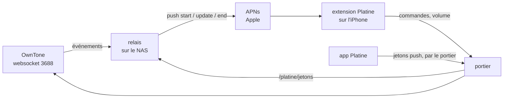

# Spec : la carte Platine tenue à jour par des push

Date : 31/10/2026. Statut : à valider par Djoko.

## Le besoin

Aujourd'hui, la carte « en cours de lecture » de Platine ne change que si l'app est ouverte (elle relit OwnTone toutes
les 2 s) ou juste après une commande passée depuis la carte. Tout ce qui se passe ailleurs lui échappe :

- le volume changé par Siri sur un HomePod ;
- un morceau qui change, une pause depuis l'interface web d'OwnTone ;
- une musique lancée par un bouton de l'app Maison : la carte n'apparaît pas, il faut ouvrir Platine.

But : **la carte suit OwnTone en permanence, app fermée, et apparaît toute seule quand une lecture démarre.**

## Le principe

iOS 27 le prévoit : une session distante se démarre, se met à jour et se termine par des notifications push
(type `nowplaying`), que le système remet à l'extension de Platine, même app fermée.

## Les pièces

### 1. Le relais (nouveau service sur le NAS)

- **Écoute OwnTone** par sa websocket (`127.0.0.1:3688`, événements `player`, `volume`, `outputs`, `queue`), puis relit
  l'état par l'API JSON, comme le fait déjà l'app (`/api/player`, `/api/outputs`, `/api/queue`).
- **Construit les attributs** de la session : exactement la structure `PlatineAttributs` de l'app (contrat partagé),
  pochette comprise, son adresse passant par le portier.
- **Décide des push** :
  - une lecture démarre et aucune session n'est ouverte → `start`, au jeton de démarrage ;
  - la piste, l'état (lecture, pause), une sortie ou un volume change → `update`, au jeton de la session ;
  - plus rien ne joue depuis un délai (voir les décisions) → `end`.
  - L'avancement dans le morceau ne déclenche pas de push : le système l'extrapole à partir de la position et de
    l'horodatage. Un saut dans le morceau en déclenche un.
- **Regroupe** les événements sur 1 s : un curseur de volume qui glisse ou une rafale d'événements d'OwnTone donne une
  seule push, avec le dernier état.
- **Signe et envoie** les push à APNs : HTTP/2, jeton d'authentification JWT (ES256) tiré de la clé APNs, renouvelé
  toutes les 50 minutes ; en-têtes `apns-push-type: nowplaying`, `apns-topic: <identifiant de l'app>.push-type.nowplaying`.
  Serveur de développement (`api.sandbox.push.apple.com`) : l'app est installée par Xcode.
- **Reçoit les jetons** de l'iPhone sur `127.0.0.1:18090`, uniquement par le portier (voir 3). Les garde dans un
  fichier (droits 600) pour les retrouver après un redémarrage.
- **Ne parle qu'en local** : rien d'ouvert sur le réseau ; il sort seulement vers APNs.
- Conteneur en lecture seule, sans capacités, mémoire plafonnée, comme le portier.

### 2. L'app et l'extension

- **Droit push** (`aps-environment: development`) ajouté à l'app : sans lui, iOS ne donne pas de jeton de démarrage
  (aujourd'hui le journal affiche « jeton de démarrage par push : absent »).
- **L'app** suit `RemoteMediaSession.pushToStartTokenUpdates` et envoie chaque nouveau jeton au relais.
- **L'extension** suit `pushTokenUpdates` de chaque session et envoie son jeton de mise à jour au relais.
- Le bouton « Démarrer ou mettre à jour » reste, en secours. Le suivi toutes les 2 s de l'app ouverte peut rester
  aussi : il ne gêne pas.

### 3. Le portier

Une route de plus, toujours derrière le jeton : `POST /platine/jetons` → relais (`127.0.0.1:18090`). Corps : le type de
jeton (`demarrage` ou `session`), l'identifiant de session, le jeton. Taille plafonnée.

### 4. La clé APNs (part de Djoko)

Sur le portail développeur d'Apple : *Certificates, Identifiers & Profiles → Keys → +*, cocher *Apple Push Notifications
service (APNs)*, télécharger le fichier `.p8` (une seule fois possible) et noter son identifiant (Key ID). Le fichier va
sur le NAS, dans le dossier du relais, droits 600, jamais dans le dépôt ni affiché. L'identifiant d'équipe et celui de
la clé vont dans le `.env` du relais.

## Ce qui reste inconnu (à lever d'abord)

1. **Le démarrage par push marche-t-il avec une app installée par Xcode**, et la carte apparaît-elle au premier plan
   sans que l'app la « mette en avant » ? (La mise en avant exige l'app au premier plan.)
2. **Le quota de push** : Apple n'en publie aucun pour ce type. Un volume réglé à la voix ou une suite de morceaux
   courts peuvent en envoyer beaucoup.
3. **La durée de vie d'une session** : combien de temps iOS garde-t-il une session sans mise à jour ?

D'où une **étape 0, essai témoin** : avec la clé APNs, envoyer à la main depuis le Mac un `start`, quelques `update` et
un `end` au jeton de démarrage que l'app aura obtenu (lu dans son conteneur partagé par `devicectl`), et observer
l'iPhone. Le relais ne se construit que si l'essai est concluant.

## Les décisions à prendre

| # | Question | Proposition |
|---|---|---|
| 1 | Langage du relais | **Go** : un seul binaire, HTTP/2 et signature ES256 dans la bibliothèque standard, une dizaine de Mo de mémoire (le NAS est déjà chargé). Python serait plus court à lire, au prix de dépendances et de mémoire. |
| 2 | Quand la carte disparaît | **Arrêt** (`stop`) : `end` après 2 minutes. **Pause** : la carte reste 30 minutes, puis `end`. |
| 3 | Regroupement | 1 seconde, dernier état seulement. |
| 4 | Environnement APNs | Développement tant que l'app passe par Xcode. Production le jour d'une diffusion par TestFlight. |
| 5 | Ordre de travail | Étape 0 (essai témoin), puis relais, puis app et extension, puis route du portier, puis banc. |

## Hors périmètre

- La diffusion par TestFlight ou l'App Store.
- La fiabilité d'OwnTone face aux refus de Spotify (suivie à part).
- Le choix des enceintes depuis la carte (activer ou couper un HomePod) : la carte règle le volume des enceintes déjà
  actives, rien de plus.
