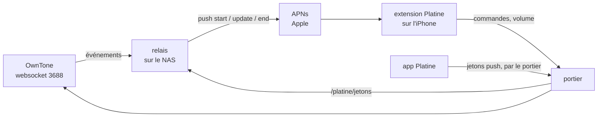

# Spec : la carte Platine tenue à jour par des push

Date : 31/10/2026. Statut : validée par Djoko ; relais construit (`relais/`) et passé au banc le 31/10/2026.

## Le besoin

Aujourd'hui, la carte « en cours de lecture » de Platine ne change que si l'app est ouverte (elle relit OwnTone toutes
les 2 s) ou juste après une commande passée depuis la carte. Tout ce qui se passe ailleurs lui échappe :

- le volume changé par Siri sur un HomePod ;
- un morceau qui change, une pause depuis l'interface web d'OwnTone ;
- une musique lancée par un bouton de l'app Maison : la carte n'apparaît pas, il faut ouvrir Platine.

But : **la carte suit OwnTone en permanence, app fermée, et apparaît toute seule quand une lecture démarre.**

## Le principe

iOS 27 le prévoit : une session distante se démarre, se met à jour et se termine par des notifications push
(type `nowplaying`), que le système remet à l'extension de Platine, même app fermée.

## Les pièces

### 1. Le relais (nouveau service sur le NAS)

- **Écoute OwnTone** par sa websocket (`127.0.0.1:3688`, événements `player`, `volume`, `outputs`, `queue`), puis relit
  l'état par l'API JSON, comme le fait déjà l'app (`/api/player`, `/api/outputs`, `/api/queue`).
- **Construit les attributs** de la session : exactement la structure `PlatineAttributs` de l'app (contrat partagé),
  pochette comprise, son adresse passant par le portier.
- **Décide des push** :
  - une lecture démarre et aucune session n'est ouverte → `start`, au jeton de démarrage ;
  - la piste, l'état (lecture, pause), une sortie ou un volume change → `update`, au jeton de la session ;
  - plus rien ne joue depuis un délai (voir les décisions) → `end`.
  - L'avancement dans le morceau ne déclenche pas de push : le système l'extrapole à partir de la position et de
    l'horodatage. Un saut dans le morceau en déclenche un.
- **Regroupe** les événements sur 1 s : un curseur de volume qui glisse ou une rafale d'événements d'OwnTone donne une
  seule push, avec le dernier état.
- **Signe et envoie** les push à APNs : HTTP/2, jeton d'authentification JWT (ES256) tiré de la clé APNs, renouvelé
  toutes les 50 minutes ; en-têtes `apns-push-type: nowplaying`, `apns-topic: <identifiant de l'app>.push-type.nowplaying`.
  Serveur de développement (`api.sandbox.push.apple.com`) : l'app est installée par Xcode.
- **Reçoit les jetons** de l'iPhone sur `127.0.0.1:18090`, uniquement par le portier (voir 3). Les garde dans un
  fichier (droits 600) pour les retrouver après un redémarrage.
- **Ne parle qu'en local** : rien d'ouvert sur le réseau ; il sort seulement vers APNs.
- Conteneur en lecture seule, sans capacités, mémoire plafonnée, comme le portier.

### 2. L'app et l'extension

- **Droit push** (`aps-environment: development`) ajouté à l'app : sans lui, iOS ne donne pas de jeton de démarrage
  (aujourd'hui le journal affiche « jeton de démarrage par push : absent »).
- **L'app** suit `RemoteMediaSession.pushToStartTokenUpdates` et envoie chaque nouveau jeton au relais.
- **L'extension** suit `pushTokenUpdates` de chaque session et envoie son jeton de mise à jour au relais.
- Le bouton « Démarrer ou mettre à jour » reste, en secours. Le suivi toutes les 2 s de l'app ouverte peut rester
  aussi : il ne gêne pas.

### 3. Le portier

Une route de plus, toujours derrière le jeton : `POST /platine/jetons` → relais (`127.0.0.1:18090`). Corps : le type de
jeton (`demarrage` ou `session`), l'identifiant de session, le jeton. Taille plafonnée.

### 4. La clé APNs (part de Djoko)

Sur le portail développeur d'Apple : *Certificates, Identifiers & Profiles → Keys → +*, cocher *Apple Push Notifications
service (APNs)*, télécharger le fichier `.p8` (une seule fois possible) et noter son identifiant (Key ID). Le fichier va
sur le NAS, dans le dossier du relais, droits 600, jamais dans le dépôt ni affiché. L'identifiant d'équipe et celui de
la clé vont dans le `.env` du relais.

## Ce qui reste inconnu (à lever d'abord)

1. **Le démarrage par push marche-t-il avec une app installée par Xcode**, et la carte apparaît-elle au premier plan
   sans que l'app la « mette en avant » ? (La mise en avant exige l'app au premier plan.)
2. **Le quota de push** : Apple n'en publie aucun pour ce type. Un volume réglé à la voix ou une suite de morceaux
   courts peuvent en envoyer beaucoup.
3. **La durée de vie d'une session** : combien de temps iOS garde-t-il une session sans mise à jour ?

D'où une **étape 0, essai témoin** : avec la clé APNs, envoyer à la main depuis le Mac un `start`, quelques `update` et
un `end` au jeton de démarrage que l'app aura obtenu (lu dans son conteneur partagé par `devicectl`), et observer
l'iPhone. Le relais ne se construit que si l'essai est concluant.

## Résultats de l'essai témoin (31/10/2026)

Push envoyées à la main depuis le Mac (`scripts/essai-push.py`), journal système de l'iPhone lu par `idevicesyslog`.

- **Démarrage par push : marche.** App fermée, une push `start` au jeton de démarrage réveille l'extension (via
  `mediaremoted`), qui construit la carte ; elle apparaît dans le Centre de contrôle sans ouvrir l'app.
- **Mise à jour par push : marche.** Une push `update` au jeton de la session fait suivre la carte (morceau, pochette).
- **Format des attributs :** une date en texte ISO 8601 (comme dans l'exemple d'Apple) fait rejeter la push sans
  réveiller l'extension ; un nombre de secondes depuis 1970 passe. `horodatage` est donc un `TimeInterval`.
- **Jeton de session :** l'extension le reçoit aussi pour une session démarrée par l'app.
- **Écran verrouillé : non obtenu.** `requestToBecomeSystemPrimary` (app au premier plan) est accepté par
  `mediaremoted` (« set active session »), mais le point de lecture proactif de l'écran verrouillé reste celui qu'iOS
  a retenu (« ProactiveSystemEndpoint remains … selectionReason = UserSelected ») ; toucher la carte ou faire
  lecture et pause n'y change rien. Une fois, sans aucune enceinte active, la demande a échoué (`internalFailure`).
- **Puis, vers 14 h 55, la carte Platine est apparue d'elle-même sur l'écran verrouillé**, en premier, complète
  (lignes des enceintes, pochette, commandes, curseur de volume), la tuile native du HomePod mini en dessous. Le
  déclencheur n'est pas établi : soit une pause puis une lecture faites depuis la carte vers 14 h 36 (choix de
  l'utilisateur retenu par iOS), soit les mises à jour aux changements de morceau. À observer au banc du relais.
- **Hypothèse à vérifier si la place se perd :** la tuile native des HomePod (MediaRemote d'OwnTone) concurrence la
  carte ; essai possible en coupant MediaRemote dans OwnTone, avec des enceintes actives.
- **Paire stéréo :** réunie en une seule ligne de la carte, elle s'affiche avec l'icône « deux enceintes » (type
  `speakerGroup`, iOS 27.2) ; aucun type ne donne l'icône d'un HomePod.
- **Confirmé dans le journal :** `mediaremoted` applique une « Network restriction » à l'extension (d'où le refus du
  réseau local) ; il range la session distante sous un HomePod.

## Résultats du banc du relais (31/10/2026)

Chaîne complète : app et extension → portier → relais sur le NAS → APNs (développement) → extension. Journaux lus
depuis le Mac : relais (`donnees/relais.log` par ssh), extension (`scripts/essai-push.py journal`), système de l'iPhone
(`idevicesyslog`). Le relais occupe environ 3,5 Mo de mémoire.

- **start : marche.** À l'ouverture de l'app pendant une lecture (le jeton de démarrage arrive, la carte part aussitôt),
  et **app fermée, par un bouton de l'app Maison** : la carte apparaît d'elle-même environ 1 s après le début de la
  lecture. Le tout premier envoi à APNs a pris environ 6 s (première connexion du NAS) ; les suivants partent aussitôt.
- **update : marche** pour tout ce qui change ailleurs que sur la carte : morceau suivant (fin naturelle ou interface
  web d'OwnTone), titre et pochette compris ; volume réglé par Siri sur un HomePod (deux push : Siri règle par
  paliers) ; saut dans le morceau ; pause puis lecture. Le curseur de volume de la carte, glissé puis lâché, reste en
  place (quelques push espacées de 2 à 6 s pendant le geste, sans retour en arrière).
- **end : marche.** Deux fois, 2 min après un arrêt (vérification toutes les 5 s) : la carte disparaît, il reste le
  lecteur vide d'iOS (« À l'arrêt »). Des attributs réduits à l'identifiant de la session suffisent.
- **Jeton de session :** un nouveau à chaque session, donné par l'extension 0,6 à 5 s après le start. L'extension est
  appelée deux à quatre fois par session et le redonne à chaque fois ; le relais ignore les doublons, et le jeton d'une
  session à qui il a envoyé end.
- **Écran verrouillé : la règle constatée.** Une carte démarrée app fermée apparaît d'abord dans le Centre de contrôle ;
  elle prend l'écran verrouillé dès que l'utilisateur la touche dans le Centre de contrôle. Démarrée app au premier
  plan, elle le prend d'emblée. iOS donne donc l'écran verrouillé à une session distante après une interaction de
  l'utilisateur, ou quand elle démarre app ouverte ; une fois prise, la place reste, app fermée.
- **Extension périmée :** la première push après une réinstallation réveille l'ancienne extension, qui voit le nouveau
  binaire et s'arrête ; la nouvelle prend la suite environ 4 s plus tard.
- **Websocket d'OwnTone :** stable (pings toutes les 30 s acceptés, aucune coupure en plus d'une heure).
- **Un arrêt inexpliqué** (file vide, aucune ligne dans le journal d'OwnTone ; un refus de connexion de Spotify a
  précédé la relance) : le relais a fait ce qu'il fallait, carte à l'arrêt puis end 2 min plus tard.
- **NAS :** docker répond sans sudo par `/usr/local/bin/docker` (absent du PATH d'une session ssh). Les ACL du dossier
  partagé passent outre umask : les droits des secrets sont posés explicitement (`relais/deployer.sh`).

## Questions ouvertes

1. **Carte fermée depuis l'iPhone :** si l'utilisateur ferme la session sur l'iPhone, le relais l'ignore jusqu'au refus
   d'APNs (jeton périmé), puis repart par start à la lecture suivante. Comportement réel à observer.
2. **Priorité des push :** toutes partent en priorité 10 (immédiate). Une priorité 5 pour les update ménagerait la
   batterie et le quota, au risque d'un retard d'affichage.
3. **MediaRemote d'OwnTone :** l'écran verrouillé s'obtient sans le couper (règle ci-dessus). Le couper reste à décider,
   selon que la tuile native du HomePod gêne ou non.

## Les décisions (validées par Djoko le 31/10/2026)

| # | Question | Proposition |
|---|---|---|
| 1 | Langage du relais | **Go** : un seul binaire, HTTP/2 et signature ES256 dans la bibliothèque standard, une dizaine de Mo de mémoire (le NAS est déjà chargé). Python serait plus court à lire, au prix de dépendances et de mémoire. |
| 2 | Quand la carte disparaît | **Arrêt** (`stop`) : `end` après 2 minutes. **Pause** : la carte reste 30 minutes, puis `end`. |
| 3 | Regroupement | 1 seconde, dernier état seulement. Mis en œuvre comme une seconde de calme après le dernier événement, 5 s d'attente au plus. |
| 4 | Environnement APNs | Développement tant que l'app passe par Xcode. Production le jour d'une diffusion par TestFlight. |
| 5 | Ordre de travail | Étape 0 (essai témoin), puis relais, puis app et extension, puis route du portier, puis banc. |

## Hors périmètre

- La diffusion par TestFlight ou l'App Store.
- La fiabilité d'OwnTone face aux refus de Spotify (suivie à part).
- Le choix des enceintes depuis la carte (activer ou couper un HomePod) : la carte règle le volume des enceintes déjà
  actives, rien de plus.
